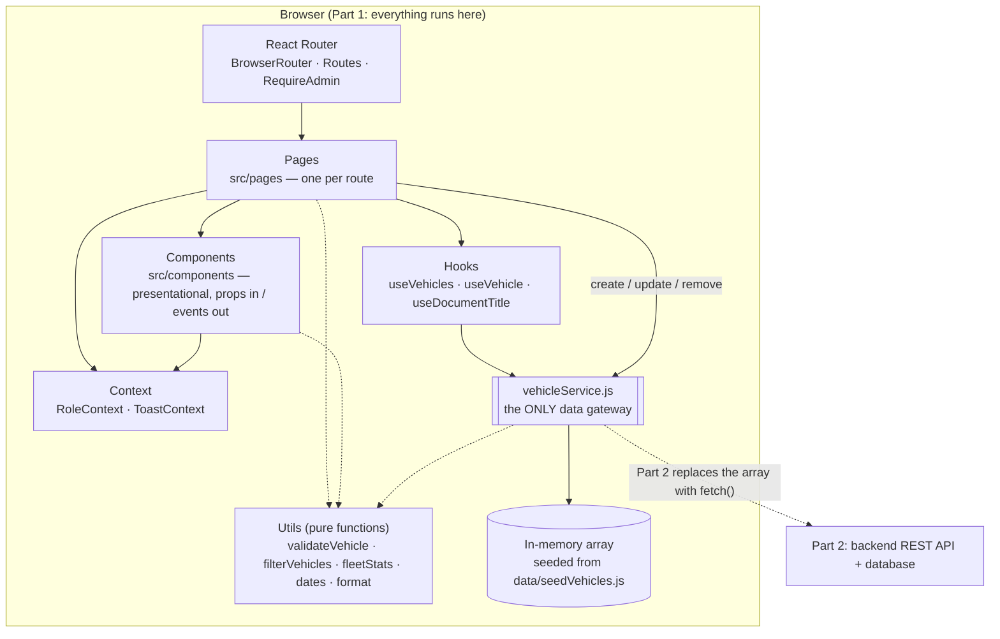
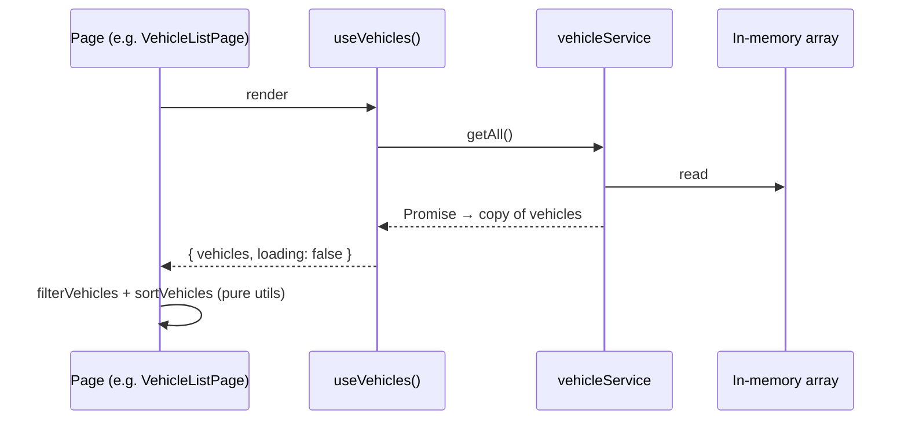

# Masar — Architecture

| | |
|---|---|
| **Project** | Masar — Vehicle Fleet Manager (Part 1) |
| **Repository** | <https://github.com/Fahadd2/Masar> |
| **Based on** | [REQUIREMENTS.md](REQUIREMENTS.md) v1.3, [DESIGN.md](DESIGN.md) v1.3 |
| **Date** | 2026-10-17 |

## Contents

1. [Overview](#1-overview)
2. [Technology stack](#2-technology-stack)
3. [Folder structure](#3-folder-structure)
4. [Data flow and the service boundary](#4-data-flow-and-the-service-boundary)
5. [State management](#5-state-management)
6. [Routing](#6-routing)
7. [Features mapped to requirements](#7-features-mapped-to-requirements)
8. [Testing approach](#8-testing-approach)
9. [Known limitations](#9-known-limitations)

---

## 1. Overview

Masar is a single-page React application. In Part 1 there is no server: the browser downloads the
built app, and all vehicle data lives in a JavaScript array inside one module,
`src/services/vehicleService.js`. Everything above that module talks to it through a small,
Promise-based API, so Part 2 can replace the array with HTTP calls to a backend without changing any
page or component.



Layer rules (enforced by code review and, for rule 1, by ESLint):

1. Only `vehicleService.js` imports `data/seedVehicles.js` or touches the vehicle array
   (`no-restricted-imports` in `eslint.config.js`).
2. Pages fetch data through hooks or the service; components below the pages receive data only
   through props (except `Navbar`, `RoleSwitcher` and `RequireAdmin`, which read `RoleContext`).
3. `utils/` contains pure functions with no React and no data access, so they can be unit tested in
   isolation and reused by both the UI and the service.

## 2. Technology stack

Versions are the ranges in `package.json`; `package-lock.json` pins the exact installed versions.

### Runtime dependencies

| Library | Version | Why it was chosen |
|---|---|---|
| React | ^19.3.1 | Required by the brief; function components and hooks keep the UI declarative and testable. |
| React DOM | ^19.3.1 | Renders React in the browser. |
| React Router | ^7.18.4 | Client-side routing with URL parameters (`/vehicles/:id`) and query state (`useSearchParams`). Used in simple declarative mode (`<Routes>`/`<Route>`), imported from `react-router`. Version 7 chosen over the newer 8 for stability. |

### Build and quality tools (dev dependencies)

| Tool | Version | Why it was chosen |
|---|---|---|
| Vite | ^7.3.7 | Fast dev server and production build; supports CSS Modules with no extra setup. Version 7 chosen over the newer 8 for stability. |
| @vitejs/plugin-react | ^5.2.0 | JSX transform and Fast Refresh for Vite 7. |
| CSS Modules + CSS custom properties | (built into Vite) | Scoped component styles and design tokens without a UI library (DESIGN §3). |
| ESLint | ^9.39.5 | Catches bugs and enforces project rules (seed-data import restriction, no `eval`, no `dangerouslySetInnerHTML`). Flat config in `eslint.config.js`. |
| @eslint/js | ^9.39.5 | ESLint's recommended JavaScript rules. |
| eslint-plugin-react-hooks | ^5.2.0 | Rules of Hooks and effect dependency checks. |
| eslint-plugin-react-refresh | ^0.4.26 | Keeps modules compatible with Fast Refresh. |
| globals | ^16.5.0 | Browser global variable definitions for ESLint. |

### Testing tools (dev dependencies)

| Tool | Version | Why it was chosen |
|---|---|---|
| Vitest | ^4.1.12 | Test runner that reuses the Vite config; compatible with Vite 7. Version 4.1.12 chosen because Vitest 3.x had open security advisories (`npm audit` is clean with 4.1.12). |
| @vitest/coverage-v8 | ^4.1.12 | Code coverage using V8's built-in instrumentation. |
| jsdom | ^26.1.0 | Browser-like DOM for component tests. |
| @testing-library/react | ^16.3.3 | Renders components and queries them the way users find them (roles, labels, text). |
| @testing-library/dom | ^10.4.2 | Required peer of React Testing Library 16. |
| @testing-library/user-event | ^14.6.8 | Simulates real typing, clicking and tabbing. |
| @testing-library/jest-dom | ^6.10.0 | Readable DOM assertions (`toHaveFocus`, `toBeDisabled`, …). |

Node.js 20.19+ is required by Vite 7 (developed on Node 24).

## 3. Folder structure

```text
Masar/
├── index.html                    # HTML shell, <title>Masar</title>
├── package.json                  # "name": "masar-fleet-manager"; scripts: dev, build, lint, test, test:coverage
├── vite.config.js                # Vite + Vitest configuration
├── eslint.config.js              # lint rules, incl. the seed-data import restriction
├── README.md
├── docs/                         # REQUIREMENTS, DESIGN, ARCHITECTURE, TEST_REPORT, CODE_REVIEW
├── public/favicon.svg
└── src/
    ├── main.jsx                  # createRoot → RoleProvider → ToastProvider → BrowserRouter → App
    ├── App.jsx                   # route table (section 6)
    ├── services/
    │   ├── vehicleService.js     # ★ the only data gateway (section 4)
    │   └── __tests__/
    ├── data/
    │   ├── seedVehicles.js       # the 10 seed vehicles (REQUIREMENTS §6)
    │   └── teamMembers.js        # About page project and team data
    ├── constants/vehicle.js      # types, statuses, departments, roles, plate letters, 30-day window
    ├── context/                  # RoleContext, ToastContext
    ├── hooks/                    # useVehicles, useVehicle, useDocumentTitle
    ├── utils/                    # dates, format, validateVehicle, filterVehicles, fleetStats
    │   └── __tests__/
    ├── components/
    │   ├── layout/               # Layout, Navbar, RoleSwitcher, RequireAdmin
    │   ├── vehicles/             # VehicleTable, VehicleForm, SearchBar, FilterBar, StatusBadge,
    │   │                         #   ServiceTag, DeleteVehicleDialog, VehicleNotFound
    │   ├── dashboard/            # StatCard, ServiceDueList
    │   └── common/               # Button, FormField, ConfirmDialog, EmptyState, PageHeader,
    │                             #   Toast, ToastRegion
    ├── pages/                    # Dashboard, VehicleList, VehicleDetails, AddVehicle, EditVehicle,
    │                             #   About, AccessDenied, NotFound
    ├── styles/                   # tokens.css (design tokens), global.css
    ├── test/                     # setup.js (jest-dom, fixed date, <dialog> stub), renderApp.jsx
    └── __tests__/                # integration tests (add, edit, delete, browse)
```

Each component has a co-located CSS Module (`VehicleTable.jsx` + `VehicleTable.module.css`).

## 4. Data flow and the service boundary

### 4.1 The `vehicleService` API

| Function | Part 1 behaviour | Part 2 replacement |
|---|---|---|
| `getAll()` | Resolves a copy of every vehicle | `GET /api/vehicles` |
| `getById(id)` | Resolves a copy, or `null` for an unknown/non-numeric id | `GET /api/vehicles/:id` (404 → `null`) |
| `create(input)` | Validates with `validateVehicle`, normalises, assigns `nextId++`, stores | `POST /api/vehicles` |
| `update(id, input)` | Validates against the stored record, replaces fields, keeps `id` | `PUT /api/vehicles/:id` |
| `remove(id)` | Deletes; `nextId` is unchanged | `DELETE /api/vehicles/:id` |
| `isPlateTaken(plate, excludeId)` | Case-insensitive check | `GET /api/vehicles?plate=…` |
| `ValidationError` / `NotFoundError` | Thrown for invalid input / unknown id | Mapped from HTTP 400/409 and 404 |
| `resetVehicleData()` | Reloads the seed data (startup and tests) | Removed |

Guarantees that callers rely on, and that Part 2 must keep:

- **Every function returns a Promise.** A `SIMULATED_LATENCY_MS` delay (150 ms; 0 under Vitest) makes
  loading states visible now, so real network latency will not surprise the UI later.
- **Results are copies** (`structuredClone`), so no component can change stored data by mutating an
  object it received.
- **Validation is repeated in the service.** The form validates for user experience; the service
  validates again before storing. In Part 2 the backend must do the same (REQUIREMENTS NFR-24).
- **Ids come from a `nextId` counter** that only increases, so ids are never reused (AC-4.7).

### 4.2 Read flow



### 4.3 Write flow

Pages call the service directly for writes, then show a toast and navigate or reload. The full
create / update / delete sequence diagram is in [DESIGN §8.3](DESIGN.md#83-data-flow-create-update-and-delete).

```text
VehicleForm --onSubmit(values)--> AddVehiclePage --create(values)--> vehicleService --push--> array
                                        |                                  |
                                        |<-- resolve(copy) ----------------+   (or reject ValidationError →
                                        |                                       VehicleForm shows field errors)
                                        +--> notify("Vehicle … added.") --> navigate("/vehicles/:id")
```

### 4.4 What changes in Part 2

Only the bodies of the functions in `vehicleService.js` change (the in-memory array, `respond()` and
`resetVehicleData()` go away; `fetch()` calls come in). The function names, arguments, return shapes
and error classes stay the same, so pages, hooks, components and the integration tests' assertions do
not need to change. The role switcher is also replaced by real authentication (section 9).

## 5. State management

There is no global store library; each kind of state lives in the simplest place that works.

| State | Where it lives | Who uses it | Notes |
|---|---|---|---|
| Vehicle data | `vehicleService.js` (module-level array + `nextId`) | All pages, via hooks and service calls | Single source of truth; lost on page reload (Part 1). |
| Loaded data for a page | `useVehicles` / `useVehicle` hook state | The page that called the hook | Fetched on mount; `reload()` refetches after a delete. The dashboard refetches on every visit, so its counts always reflect this session's changes (FR-37). |
| Current role | `RoleContext` (`role`, `setRole`, `isAdmin`) | Navbar, RoleSwitcher, RequireAdmin, pages | Starts as Admin (FR-42); not persisted. Presentation only, not security (REQUIREMENTS §7.3). |
| Notifications | `ToastContext` (`toasts`, `notify`, `dismiss`) | Pages, VehicleForm, ToastRegion | Provider sits above the router, so toasts survive navigation. Max 3, auto-dismiss after 4 s. |
| Search and filters | URL query string `?q=&status=&type=` (`useSearchParams`) | VehicleListPage | Dashboard status cards link to `/vehicles?status=…` (FR-38); back/forward and refresh keep the filter. |
| Sort column/direction | `VehicleListPage` component state | VehicleTable | Resets when leaving the page. |
| Form values, touched fields, errors | `VehicleForm` component state | VehicleForm | Errors are recomputed from the values on each render (`validate(values)`). |
| Dialog open / mobile menu open | Component state | ConfirmDialog owner, Navbar | — |

## 6. Routing

Defined in `src/App.jsx`. All routes render inside `Layout` (navbar, `<main>`, toast region).

| Route | Page | Guard | `document.title` |
|---|---|---|---|
| `/` | `DashboardPage` | — | Dashboard — Masar |
| `/vehicles` | `VehicleListPage` | — | Vehicles — Masar |
| `/vehicles/new` | `AddVehiclePage` | `RequireAdmin` | Add vehicle — Masar |
| `/vehicles/:id` | `VehicleDetailsPage` | — | *plate* — Masar |
| `/vehicles/:id/edit` | `EditVehiclePage` | `RequireAdmin` | Edit *plate* — Masar |
| `/about` | `AboutPage` | — | About — Masar |
| `*` | `NotFoundPage` | — | Page not found — Masar |

`RequireAdmin` renders `AccessDeniedPage` in place of the page for a Viewer, without changing the URL
(FR-45). After each client-side navigation, `Layout` moves keyboard focus to `<main>` and scrolls to
the top.

## 7. Features mapped to requirements

| Feature | Requirements | Main implementation | Tests |
|---|---|---|---|
| Navigation bar, active link, hamburger menu, Masar logo, page titles | FR-1 – FR-4, FR-47 | `Navbar`, `Layout`, `useDocumentTitle` | `browse.test.jsx` |
| 404 page | FR-5 | `NotFoundPage` | `browse.test.jsx` |
| Vehicle table with all columns, badges, formatted values, "Unassigned" | FR-6 – FR-8 | `VehicleTable`, `StatusBadge`, `utils/format.js` | `browse.test.jsx`, `format.test.js` |
| Overdue / Due soon tags | FR-9 | `ServiceTag`, `getServiceState` | `dates.test.js` |
| Sortable columns | FR-10 | `VehicleTable`, `sortVehicles` | `filterVehicles.test.js`, `browse.test.jsx` |
| Result count, empty states | FR-11, FR-12 | `VehicleListPage`, `EmptyState` | `browse.test.jsx` |
| Vehicle details, formatted values, not found, Admin actions | FR-13 – FR-16 | `VehicleDetailsPage` | `browse.test.jsx`, `deleteVehicle.test.jsx` |
| Add vehicle with validation, success toast, cancel | FR-17 – FR-20 | `AddVehiclePage`, `VehicleForm`, `validateVehicle` | `addVehicle.test.jsx`, `validateVehicle.test.js` |
| Edit vehicle, pre-fill, cancel, not found | FR-21 – FR-24 | `EditVehiclePage`, `VehicleForm` | `editVehicle.test.jsx` |
| Delete with confirmation, cancel | FR-25 – FR-28 | `DeleteVehicleDialog`, `ConfirmDialog` | `deleteVehicle.test.jsx` |
| Search, status/type filters, AND logic, clear | FR-29 – FR-32 | `SearchBar`, `FilterBar`, `filterVehicles` | `filterVehicles.test.js`, `browse.test.jsx` |
| Dashboard totals, per-status counts, service-due list, links | FR-33 – FR-38 | `DashboardPage`, `StatCard`, `ServiceDueList`, `fleetStats` | `fleetStats.test.js`, `browse.test.jsx` |
| About page with team and course | FR-39 – FR-41 | `AboutPage`, `data/teamMembers.js` | `browse.test.jsx` |
| Admin/Viewer role switcher, hidden controls, Access denied | FR-42 – FR-45 | `RoleContext`, `RoleSwitcher`, `RequireAdmin`, `AccessDeniedPage` | `browse.test.jsx` |
| Success/error notifications | FR-46 | `ToastContext`, `ToastRegion`, `Toast` | add/edit/delete tests |
| Validation rules V-PL-1 … V-NS-4 | REQUIREMENTS §2.2 | `utils/validateVehicle.js` (form and service) | `validateVehicle.test.js` |
| Unique, never-reused ids | §2.2 id rule, AC-4.7 | `vehicleService` `nextId` | `vehicleService.test.js` |

## 8. Testing approach

See [TEST_REPORT.md](TEST_REPORT.md) for the latest results and coverage.

- **Unit tests** (`src/utils/__tests__`, `src/services/__tests__`) test pure functions and the service
  directly: every validation rule, date edge cases (invalid dates, leap years, the 30-day boundary),
  formatting, search/filter/sort, dashboard statistics, and service behaviour (copies, `nextId`,
  error classes).
- **Integration tests** (`src/__tests__`) render the whole app with the real providers and a
  `MemoryRouter` (`src/test/renderApp.jsx`) and drive it with user-event the way a user would: by
  labels, roles and visible text.
- **Deterministic:** `src/test/setup.js` fixes "today" to 2026-10-17 with `vi.setSystemTime`, resets
  the seed data before every test, and sets `SIMULATED_LATENCY_MS` to 0 (via Vitest's test mode).
  Unit tests also pass the `today` argument explicitly.
- **jsdom gaps:** jsdom has no `<dialog>` support or layout engine, so `showModal`/`close` are stubbed
  and responsive layout was checked manually in a browser at 320 px, 375 px and desktop widths.

## 9. Known limitations

| Limitation | Impact | Planned for |
|---|---|---|
| Data is in memory only | Every reload resets to the 10 seed vehicles; two browser tabs do not share changes. | Part 2 (database) |
| The role switcher is not a security control | Anyone can switch to Admin or change client-side code. It only demonstrates role-based UI (NFR-24). | Part 2 (authentication + server-side authorization) |
| Validation is client-side only | It improves user experience but can be bypassed; it does not protect data. | Part 2 (server-side validation) |
| "Today" is the browser's local date | Service-due results depend on the device's clock and time zone. | Part 2 may compute this on the server |
| Seed service dates are fixed | The dashboard's service-due list changes as real time passes (see REQUIREMENTS §6). | Adjust seed dates before a demo |
| Search needs the plate's space | "KSA4821" does not match "KSA 4821" (substring search, as specified). | Possible enhancement |
| No pagination | The table shows all vehicles; fine for the expected size (NFR-13: 1,000 vehicles). | Possible enhancement |
| English only | No Arabic interface or right-to-left layout (Arabic names in data are supported). | Out of scope for Part 1 |
| Mobile menu | Closes on link click and Escape, not on a tap outside it. | Possible enhancement |
