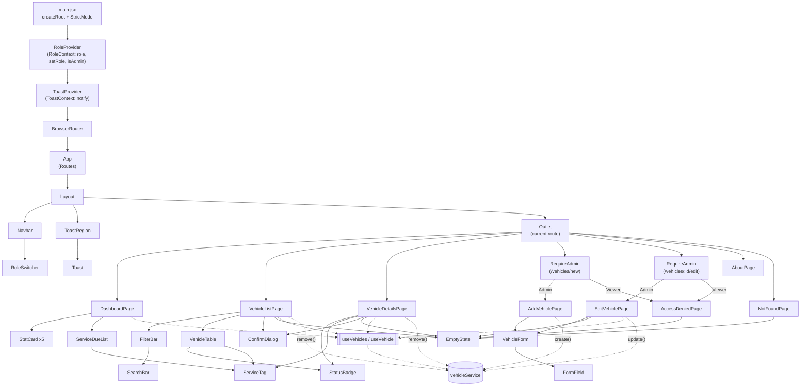
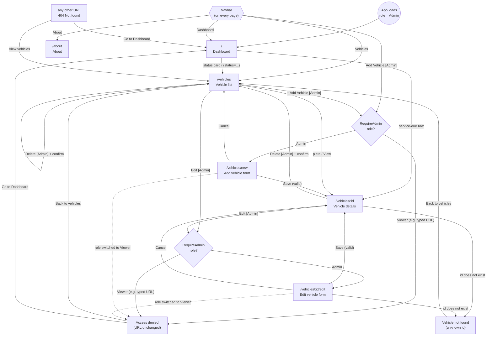
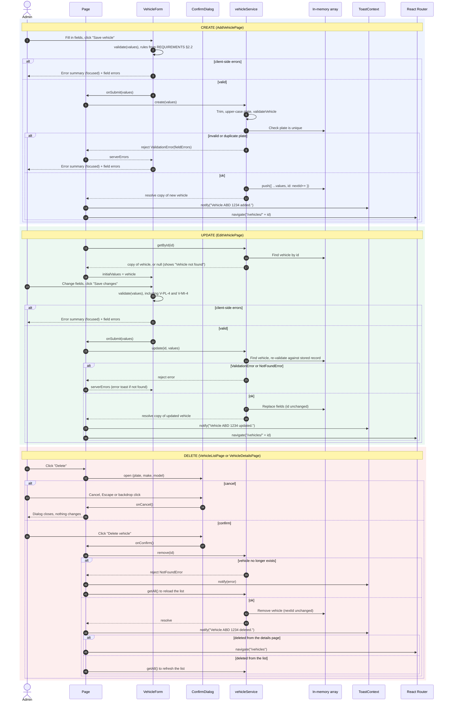
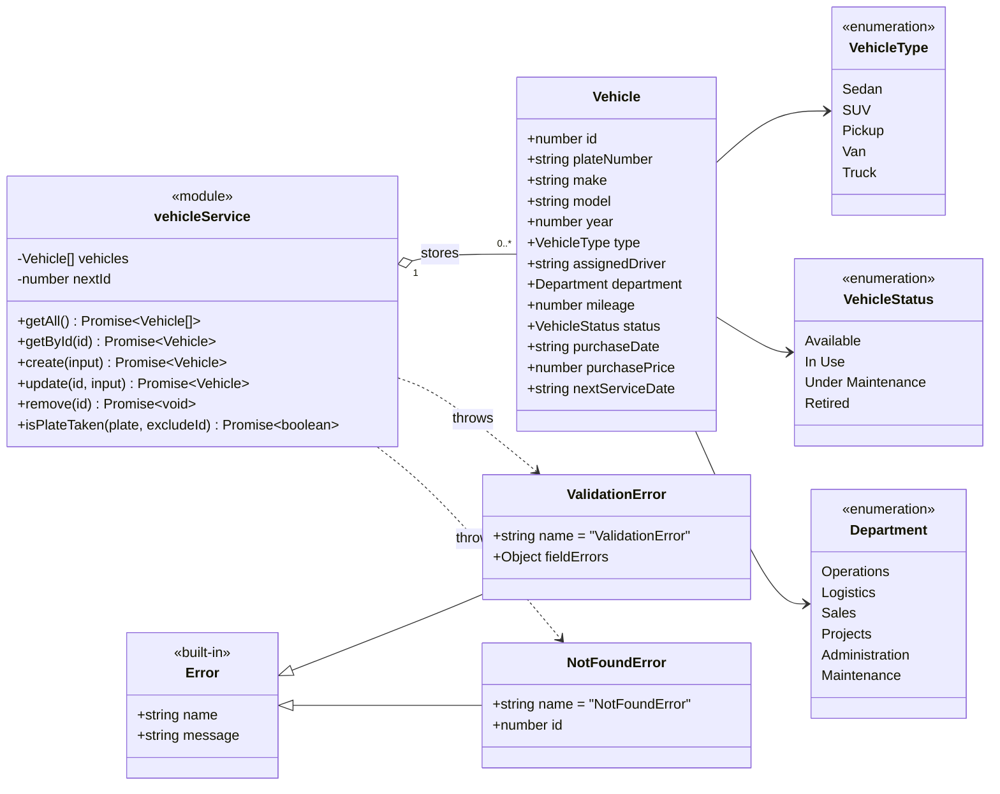

# Masar — Vehicle Fleet Manager

| | |
|---|---|
| **Document** | UI/UX and front-end architecture design (Part 1) |
| **Project** | Masar — Vehicle Fleet Manager |
| **Repository** | <https://github.com/Fahadd2/Masar> |
| **Version** | 1.3 |
| **Based on** | [`REQUIREMENTS.md`](REQUIREMENTS.md) v1.3 |
| **Stack** | Vite + React + React Router, plain CSS (CSS Modules + design tokens) |
| **Date** | 2026-10-17 |

Requirement IDs (FR-x, NFR-x, US-x) refer to `REQUIREMENTS.md`.

### Change log

| Version | Date | Changes |
|---|---|---|
| 1.3 | 2026-10-17 | Renamed the app to **Masar** (subtitle "Vehicle Fleet Manager"): title and project line, navbar logo text in all wireframes, sitemap root, About page, Access denied title. Added [§3.6 Brand and naming](#36-brand-and-naming) (page titles, package name `masar-fleet-manager`, README title) and the `useDocumentTitle` hook. Folder tree root is now the `Masar` repository. |
| 1.2 | 2026-10-17 | Added [section 8, Diagrams](#8-diagrams) (component hierarchy, navigation flow, create/update/delete sequence, class diagram). Added this change log and a version number. Focus-on-failed-submit rule (error summary gets focus) now matches REQUIREMENTS §2.3 v1.2. `main.jsx` order clarified as providers → `BrowserRouter`; `update()` documented as rejecting with `NotFoundError`. |
| 1.1 | 2026-10-17 | Aligned with REQUIREMENTS v1.1: Admin shown as the default role in §7.1; plate examples changed to `ABD 1234`. |
| 1.0 | 2026-10-17 | First version. |

## Contents

1. [Sitemap and navigation](#1-sitemap-and-navigation)
2. [Wireframes](#2-wireframes)
3. [Visual style guide](#3-visual-style-guide)
4. [Reusable components](#4-reusable-components)
5. [UX behaviours](#5-ux-behaviours)
6. [Folder structure and architecture](#6-folder-structure-and-architecture)
7. [Role-based UI](#7-role-based-ui)
8. [Diagrams](#8-diagrams)

---

## 1. Sitemap and navigation

### 1.1 Sitemap

```text
Masar
|
+-- Dashboard ................ /                     (all roles)
|
+-- Vehicles ................. /vehicles             (all roles)
|   |                          ?q=&status=&type=     (search/filter state in the URL)
|   +-- Vehicle details ...... /vehicles/:id         (all roles)
|   |   +-- Edit vehicle ..... /vehicles/:id/edit    (Admin only; Viewer -> Access denied)
|   +-- Add vehicle .......... /vehicles/new         (Admin only; Viewer -> Access denied)
|
+-- About .................... /about                (all roles)
|
+-- Not found (404) .......... *                     (any unknown URL)
```

### 1.2 Route table

| Route | Page component | Guard | Navbar item highlighted |
|---|---|---|---|
| `/` | `DashboardPage` | — | Dashboard |
| `/vehicles` | `VehicleListPage` | — | Vehicles |
| `/vehicles/new` | `AddVehiclePage` | `RequireAdmin` | Add Vehicle |
| `/vehicles/:id` | `VehicleDetailsPage` | — | Vehicles |
| `/vehicles/:id/edit` | `EditVehiclePage` | `RequireAdmin` | Vehicles |
| `/about` | `AboutPage` | — | About |
| `*` | `NotFoundPage` | — | none |

React Router ranks `/vehicles/new` above `/vehicles/:id`, so "new" is never treated as an id.

### 1.3 Top navbar

| Position | Item | Target | Visible to |
|---|---|---|---|
| Left | Logo text **"Masar"** (FR-47) | `/` | All |
| Centre | **Dashboard** | `/` | All |
| Centre | **Vehicles** | `/vehicles` | All |
| Centre | **Add Vehicle** | `/vehicles/new` | Admin only (FR-1) |
| Centre | **About** | `/about` | All |
| Right | Role switcher `Viewer \| Admin` | — | All (demo control, see [section 7](#7-role-based-ui)) |

The active item uses `NavLink` with an underline and bold weight (FR-2). `Dashboard` uses `end`
matching so it is not highlighted on every route.

### 1.4 Main user flows

```text
Browse:   Dashboard --click status card--> Vehicles?status=In+Use --click plate--> Details
Search:   Vehicles --type in search / choose filters--> table updates live --click plate--> Details
Add:      [Admin] Navbar "Add Vehicle" --> Form --Save (valid)--> Details + "Vehicle added" toast
Edit:     [Admin] Details "Edit" --> Form (pre-filled) --Save (valid)--> Details + "Vehicle updated" toast
Delete:   [Admin] Table row / Details "Delete" --> Confirm dialog --Delete--> Vehicles + "Vehicle deleted" toast
Service:  Dashboard service-due list --click row--> Details
```

---

## 2. Wireframes

Wireframes show desktop layouts (about 1280 px wide) unless marked *mobile*. `[ Button ]` is a button,
`[____]` is an input, `[ v]` is a drop-down, `( )` is a badge. All wireframes are shown in the
**Admin** role; [section 7](#7-role-based-ui) shows what changes for a Viewer.

### 2.1 Dashboard — `/`

```text
+------------------------------------------------------------------------------+
| Masar           Dashboard  Vehicles  Add Vehicle  About   Role [Viewer|Admin]|
|                 =========                                                    |
+------------------------------------------------------------------------------+
|                                                                              |
|  Dashboard                                                                   |
|  Overview of the company fleet                                               |
|                                                                              |
|  +------------+ +------------+ +------------+ +------------+ +------------+  |
|  | Total      | | Available  | | In Use     | | Under      | | Retired    |  |
|  | vehicles   | |            | |            | | Maintenance| |            |  |
|  |            | |            | |            | |            | |            |  |
|  |     10     | |      3     | |      4     | |      2     | |      1     |  |
|  |            | | View  ->   | | View  ->   | | View  ->   | | View  ->   |  |
|  +------------+ +------------+ +------------+ +------------+ +------------+  |
|                  green bar      blue bar       amber bar      grey bar       |
|                                                                              |
|  +------------------------------------------------------------------------+  |
|  | Service due in the next 30 days            5 vehicles need service     |  |
|  +------------------------------------------------------------------------+  |
|  | Plate      Vehicle               Next service    Due                   |  |
|  | ---------------------------------------------------------------------- |  |
|  | TXE 7712   Nissan Patrol         10 Oct 2026     (7 days overdue)      |  |
|  | DRT 5560   Ford F-150            22 Oct 2026     in 5 days             |  |
|  | LNB 3390   Toyota Land Cruiser   28 Oct 2026     in 11 days            |  |
|  | KSA 4821   Toyota Hilux          05 Nov 2026     in 19 days            |  |
|  | ZGU 6630   Toyota Hiace          12 Nov 2026     in 26 days            |  |
|  +------------------------------------------------------------------------+  |
|                                                                              |
+------------------------------------------------------------------------------+
```

- Status cards link to `/vehicles?status=<status>` (FR-38). The Total card links to `/vehicles`.
- Each service row links to the vehicle's details page. Overdue rows use the red `Overdue` tag;
  others show "in N days" in muted text, with the amber `Due soon` tag on the details page (FR-35).
- Empty list: `EmptyState` "No services due in the next 30 days." (FR-36).
- Example values are the seed data on 2026-10-17.

### 2.2 Vehicle list — `/vehicles`

```text
+------------------------------------------------------------------------------+
| Masar           Dashboard  Vehicles  Add Vehicle  About   Role [Viewer|Admin]|
|                            ========                                          |
+------------------------------------------------------------------------------+
|                                                                              |
|  Vehicles                                               [ + Add Vehicle ]    |
|  Showing 4 of 10 vehicles                                                    |
|                                                                              |
|  +------------------------------------------------------------------------+  |
|  | Search  [ Q  Plate, make, model or driver...                      x ]  |  |
|  | Status  [ In Use          v]   Type  [ All types       v]   [ Clear ]  |  |
|  +------------------------------------------------------------------------+  |
|                                                                              |
|  +------------------------------------------------------------------------+  |
|  |Plate ^ |Make   |Model |Year|Type  |Driver     |Mileage  |Status|Actions|  |
|  |--------+-------+------+----+------+-----------+---------+------+-------|  |
|  |HDA 2045|Isuzu  |D-Max |2022|Pickup|Saad Al-Ot.|77,900 km|(In U)|V E D  |  |
|  |KSA 4821|Toyota |Hilux |2022|Pickup|Abdullah A.|68,450 km|(In U)|V E D  |  |
|  |RJD 1507|Hyundai|Accent|2023|Sedan |Mohammed A.|41,200 km|(In U)|V E D  |  |
|  |ZGU 6630|Toyota |Hiace |2021|Van   |Khalid Al-S|121,400  |(In U)|V E D  |  |
|  +------------------------------------------------------------------------+  |
|                                                                              |
+------------------------------------------------------------------------------+
```

- Columns in the real table (FR-6): Plate, Make, Model, Year, Type, Assigned driver, Department,
  Mileage (km), Status, Next service, Actions. Department and Next service are abbreviated out of the
  wireframe for width. Next service shows `(Overdue)` / `(Due soon)` tags (FR-9).
- `V E D` = **View**, **Edit**, **Delete** text buttons (icon + label; label visually hidden only on
  mobile cards, never removed from the accessible name).
- `^` on a sortable header = current sort column and direction (FR-10). Sortable: Plate, Make, Year,
  Mileage, Next service. Headers are `<button>`s inside `<th aria-sort>`.
- Search, status and type are stored in the URL query string (`?q=hil&status=In+Use&type=Pickup`) so
  dashboard links, refresh-free back/forward and shared links keep the filter state.
- `x` clears the search box only; `[ Clear ]` resets search and both filters (FR-32) and is shown only
  when something is active.

**Empty search result** (FR-12):

```text
|  +------------------------------------------------------------------------+  |
|  |                                                                        |  |
|  |                              ( Q )                                     |  |
|  |                   No vehicles match your search                        |  |
|  |       Nothing matches "corolla" with Status: Retired, Type: SUV.       |  |
|  |                                                                        |  |
|  |                       [ Clear search and filters ]                     |  |
|  |                                                                        |  |
|  +------------------------------------------------------------------------+  |
```

**Mobile (< 768 px)** — the table becomes a list of cards; filters stack:

```text
+--------------------------------+
| Masar                     [=]  |
+--------------------------------+
| Vehicles                       |
| Showing 10 of 10               |
| [ + Add Vehicle              ] |
|                                |
| [ Q Search...              x ] |
| [ Status: All            v   ] |
| [ Type: All              v   ] |
|                                |
| +----------------------------+ |
| | KSA 4821        (In Use)   | |
| | Toyota Hilux 2022 . Pickup | |
| | Abdullah Al-Qahtani        | |
| | Operations . 68,450 km     | |
| | Service: 05 Nov 2026       | |
| | [ View ] [ Edit ] [Delete] | |
| +----------------------------+ |
| +----------------------------+ |
| | TXE 7712   (Under Maint.)  | |
| | Nissan Patrol 2020 . SUV   | |
| | Unassigned                 | |
| | Service: 10 Oct (Overdue)  | |
| | [ View ] [ Edit ] [Delete] | |
| +----------------------------+ |
+--------------------------------+
```

### 2.3 Vehicle details — `/vehicles/:id`

```text
+------------------------------------------------------------------------------+
| Masar           Dashboard  Vehicles  Add Vehicle  About   Role [Viewer|Admin]|
|                            ========                                          |
+------------------------------------------------------------------------------+
|                                                                              |
|  < Back to vehicles                                                          |
|                                                                              |
|  KSA 4821  (In Use)                                 [ Edit ]  [ Delete ]     |
|  Toyota Hilux 2022 . Pickup                                                  |
|                                                                              |
|  +----------------------------------+  +----------------------------------+  |
|  | Vehicle                          |  | Assignment                       |  |
|  | Plate number     KSA 4821        |  | Status           (In Use)        |  |
|  | Make             Toyota          |  | Assigned driver  Abdullah        |  |
|  | Model            Hilux           |  |                  Al-Qahtani      |  |
|  | Year             2022 (4 yrs)    |  | Department       Operations      |  |
|  | Type             Pickup          |  |                                  |  |
|  +----------------------------------+  +----------------------------------+  |
|                                                                              |
|  +----------------------------------+  +----------------------------------+  |
|  | Usage and service                |  | Purchase                         |  |
|  | Mileage          68,450 km       |  | Purchase date    15 Mar 2022     |  |
|  | Next service     05 Nov 2026     |  | Purchase price   SAR 98,500.00   |  |
|  |                  (Due soon)      |  |                                  |  |
|  +----------------------------------+  +----------------------------------+  |
|                                                                              |
|  Vehicle ID: 1                                                               |
+------------------------------------------------------------------------------+
```

- Fields are rendered as `<dl>` description lists (FR-13, FR-14).
- Unknown id (`/vehicles/999`, `/vehicles/abc`): the cards are replaced by `EmptyState`
  "Vehicle not found" with `[ Back to vehicles ]` (FR-15).
- On mobile the four cards stack in one column and the Edit/Delete buttons move under the title.

### 2.4 Add / Edit vehicle (shared `VehicleForm`) — `/vehicles/new`, `/vehicles/:id/edit`

Shown here after a failed submit, so error messages are visible:

```text
+------------------------------------------------------------------------------+
| Masar           Dashboard  Vehicles  Add Vehicle  About   Role [Viewer|Admin]|
|                                      ===========                             |
+------------------------------------------------------------------------------+
|                                                                              |
|  Add vehicle                     (Edit: "Edit vehicle KSA 4821", ID 1 shown) |
|  Fields marked * are required.                                               |
|                                                                              |
|  +------------------------------------------------------------------------+  |
|  | ! Please fix 2 errors before saving:                                   |  |
|  |   - Plate number must look like ABD 1234.                              |  |
|  |   - A vehicle that is In Use must have an assigned driver.             |  |
|  +------------------------------------------------------------------------+  |
|                                                                              |
|  Identification ---------------------------------------------------------    |
|  Plate number *                      Make *                                  |
|  [ abd12               ] <- red      [ Toyota              ]                 |
|  ! Plate number must look like       Model *                                 |
|    ABD 1234.                         [ Hilux               ]                 |
|  Year *                              Type *                                  |
|  [ 2024                ]             [ Pickup            v ]                 |
|                                                                              |
|  Assignment -------------------------------------------------------------    |
|  Status *                            Department *                            |
|  [ In Use            v ]             [ Operations        v ]                 |
|  Assigned driver (required when In Use)                                      |
|  [                     ] <- red                                              |
|  ! A vehicle that is In Use must have an assigned driver.                    |
|                                                                              |
|  Usage and service ------------------------------------------------------    |
|  Mileage (km) *                      Next service date *                     |
|  [ 0                   ]             [ 2025-04-01    [cal] ]                 |
|                                                                              |
|  Purchase ---------------------------------------------------------------    |
|  Purchase date *                     Purchase price (SAR) *                  |
|  [ 2024-03-10  [cal]   ]             [ SAR | 95000.00      ]                 |
|                                                                              |
|  ----------------------------------------------------------------------      |
|                                             [ Cancel ]  [ Save vehicle ]     |
|                                                                              |
+------------------------------------------------------------------------------+
```

- Same component in both modes. Add: empty values, status defaults to `Available` (V-ST-3), button
  "Save vehicle". Edit: pre-filled, read-only "Vehicle ID: 1", button "Save changes" (FR-21).
- Fields are grouped in `<fieldset>`s with `<legend>`s; two columns on desktop, one on mobile.
- The `Assigned driver` label changes its hint with status: "(required when In Use)", or the field is
  disabled with "(not used for Retired vehicles)" when status is Retired (V-DR-1, V-DR-2).
- Next service date shows "(optional for Retired vehicles)" when status is Retired (V-NS-1).
- Cancel goes to `/vehicles` (Add) or `/vehicles/:id` (Edit) without saving (FR-20, FR-23).

### 2.5 Delete confirmation dialog

```text
+------------------------------------------------------------------------------+
|##############################################################################|
|#######  +----------------------------------------------------------+  #######|
|#######  | Delete vehicle?                                      [x] |  #######|
|#######  |                                                          |  #######|
|#######  | Delete vehicle KSA 4821 - Toyota Hilux?                  |  #######|
|#######  | This cannot be undone.                                   |  #######|
|#######  |                                                          |  #######|
|#######  |                        [ Cancel ]  [ Delete vehicle ]    |  #######|
|#######  +----------------------------------------------------------+  #######|
|##############################################################################|
+------------------------------------------------------------------------------+
   ### = dimmed page behind a modal backdrop. [ Delete vehicle ] is the red
   danger button; [ Cancel ] has focus when the dialog opens (FR-26).
```

### 2.6 About — `/about`

```text
+------------------------------------------------------------------------------+
| Masar           Dashboard  Vehicles  Add Vehicle  About   Role [Viewer|Admin]|
|                                                   =====                      |
+------------------------------------------------------------------------------+
|                                                                              |
|  About                                                                       |
|                                                                              |
|  +------------------------------------------------------------------------+  |
|  | Masar - Vehicle Fleet Manager                                          |  |
|  | Course: <course code and name>                                         |  |
|  |                                                                        |  |
|  | A web application for managing a company's vehicle fleet: browse,      |  |
|  | search, add, update and delete vehicles, and track upcoming services.  |  |
|  | Part 1 is a React front end with in-memory data; Part 2 adds a backend.|  |
|  +------------------------------------------------------------------------+  |
|                                                                              |
|  Team                                                                        |
|  +------------------------------------------------------------------------+  |
|  | Name                                      | Student ID                 |  |
|  |-------------------------------------------+----------------------------|  |
|  | <Team member name>                        | <Student ID>               |  |
|  +------------------------------------------------------------------------+  |
|                                                                              |
+------------------------------------------------------------------------------+
```

Team rows come from `src/data/teamMembers.js` (FR-41).

### 2.7 404 Not found — any unknown route

```text
+------------------------------------------------------------------------------+
| Masar           Dashboard  Vehicles  Add Vehicle  About   Role [Viewer|Admin]|
+------------------------------------------------------------------------------+
|                                                                              |
|                                                                              |
|                                    404                                       |
|                             Page not found                                   |
|                                                                              |
|                 The page "/vehicels" does not exist.                         |
|                                                                              |
|                     [ Go to Dashboard ]   [ View vehicles ]                  |
|                                                                              |
|                                                                              |
+------------------------------------------------------------------------------+
```

No navbar item is highlighted. The attempted path is rendered as text, never as HTML (NFR-22).

The **Access denied** page is shown in [section 7.4](#74-access-denied-page).

---

## 3. Visual style guide

Implemented as CSS custom properties in `src/styles/tokens.css`. Components use tokens only, never
raw hex values. Light theme only in Part 1.

### 3.1 Colour palette

**Brand and neutrals**

| Token | Hex | Use |
|---|---|---|
| `--color-primary` | `#1D4ED8` | Primary buttons, links, active nav underline, focus accents |
| `--color-primary-hover` | `#1E40AF` | Primary button hover / pressed |
| `--color-primary-subtle` | `#EFF6FF` | Selected role segment, hovered table row |
| `--color-nav-bg` | `#0F172A` | Navbar background |
| `--color-nav-text` | `#CBD5E1` | Navbar links |
| `--color-nav-text-active` | `#FFFFFF` | Active navbar link |
| `--color-bg` | `#F8FAFC` | Page background |
| `--color-surface` | `#FFFFFF` | Cards, table, form, dialog |
| `--color-border` | `#E2E8F0` | Card and table borders, dividers |
| `--color-border-strong` | `#94A3B8` | Input borders |
| `--color-text` | `#0F172A` | Body text, headings |
| `--color-text-muted` | `#475569` | Secondary text, labels, hints |
| `--color-focus` | `#2563EB` | 2 px focus ring on every interactive element |
| `--color-backdrop` | `rgba(15, 23, 42, 0.55)` | Modal backdrop |

**Feedback**

| Token | Hex | Use |
|---|---|---|
| `--color-danger` | `#DC2626` | Danger button, invalid input border |
| `--color-danger-hover` | `#B91C1C` | Danger button hover; error message text |
| `--color-danger-subtle` | `#FEE2E2` | Error summary background, Overdue tag |
| `--color-success` | `#15803D` | Success toast accent |
| `--color-success-subtle` | `#F0FDF4` | Success toast background |
| `--color-warning-text` | `#92400E` | Due soon tag text |
| `--color-warning-subtle` | `#FEF3C7` | Due soon tag background |

**Status badges** (FR-7) — text always present, so colour is never the only signal (NFR-8). Each
pair meets WCAG AA (≥ 4.5 : 1).

| Status | Background | Text | Dot / card accent | Preview |
|---|---|---|---|---|
| Available | `#DCFCE7` | `#166534` | `#16A34A` | 🟢 `( Available )` |
| In Use | `#DBEAFE` | `#1E40AF` | `#2563EB` | 🔵 `( In Use )` |
| Under Maintenance | `#FEF3C7` | `#92400E` | `#D97706` | 🟠 `( Under Maintenance )` |
| Retired | `#E2E8F0` | `#334155` | `#64748B` | ⚪ `( Retired )` |

**Service tags**

| Tag | Background | Text | Shown when |
|---|---|---|---|
| Overdue | `#FEE2E2` | `#B91C1C` | Next service date before today (not Retired) |
| Due soon | `#FEF3C7` | `#92400E` | Next service date within 30 days (not Retired) |

### 3.2 Typography

- **Font family:** system UI stack — no web-font download:
  `system-ui, -apple-system, "Segoe UI", Roboto, "Helvetica Neue", Arial, "Noto Sans Arabic", sans-serif`
  (`Noto Sans Arabic` / system fallbacks render Arabic driver names correctly).
- **Numbers:** `font-variant-numeric: tabular-nums` in tables, stat cards, mileage and prices so digits
  line up.
- **Plate numbers:** monospace stack `ui-monospace, "Cascadia Mono", Consolas, monospace`, letter
  spacing `0.05em`.

| Token | Size / line height | Weight | Use |
|---|---|---|---|
| `--text-display` | 48 px / 1.1 | 700 | "404" on the Not found page |
| `--text-h1` | 28 px / 1.25 | 700 | Page titles |
| `--text-h2` | 20 px / 1.3 | 600 | Card and section titles, dialog title |
| `--text-stat` | 36 px / 1.1 | 700 | Stat card numbers |
| `--text-body` | 16 px / 1.5 | 400 | Body text, inputs |
| `--text-small` | 14 px / 1.45 | 400 / 500 | Table cells, labels, hints, error messages |
| `--text-xs` | 12 px / 1.4 | 600 | Badges, tags (sentence case, not all caps) |

Body text is never smaller than 14 px; inputs are 16 px so mobile Safari does not zoom on focus.

### 3.3 Spacing, layout and shape

| Token | Value | | Token | Value |
|---|---|---|---|---|
| `--space-1` | 4 px | | `--radius-sm` | 4 px (badges, tags) |
| `--space-2` | 8 px | | `--radius-md` | 6 px (buttons, inputs) |
| `--space-3` | 12 px | | `--radius-lg` | 8 px (cards, dialog) |
| `--space-4` | 16 px | | `--radius-full` | 9999 px (role switcher pill) |
| `--space-6` | 24 px | | `--shadow-card` | `0 1px 2px rgba(15,23,42,.06)` |
| `--space-8` | 32 px | | `--shadow-dialog` | `0 20px 40px rgba(15,23,42,.25)` |
| `--space-12` | 48 px | | `--container-max` | 1200 px |

- **Grid:** content is centred in a container of max 1200 px with 24 px side padding (16 px on mobile).
- **Breakpoints:** `< 768 px` mobile (hamburger nav, cards instead of table, one-column form);
  `768–1023 px` tablet (table scrolls horizontally inside its container); `≥ 1024 px` desktop.
- **Rhythm:** 24 px between page sections, 16 px inside cards, 12 px between form fields in a column,
  32 px between fieldsets.
- **Touch targets:** at least 44 × 44 px on mobile, 36 px tall minimum on desktop.

### 3.4 Buttons

| Variant | Default | Hover | Use |
|---|---|---|---|
| **Primary** | bg `#1D4ED8`, text white | bg `#1E40AF` | One main action per screen: Save vehicle, + Add Vehicle, Go to Dashboard |
| **Secondary** | bg white, text `#0F172A`, 1 px border `#94A3B8` | bg `#F1F5F9` | Cancel, Edit, Clear, Back |
| **Danger** | bg `#DC2626`, text white | bg `#B91C1C` | Delete vehicle (in dialog and details page) |
| **Ghost / text** | no bg, text `#1D4ED8` | underline, bg `#EFF6FF` | Table row actions (View, Edit), "View ->" links; row Delete uses red text `#B91C1C` |

Shared rules:

- Height 40 px (44 px on mobile), padding `0 16px`, radius 6 px, weight 600, 14–16 px text.
- Icon + label; icon-only buttons are not used except the dialog close `[x]` and hamburger `[=]`,
  which carry `aria-label`.
- **Focus:** `:focus-visible` shows a 2 px `#2563EB` outline with 2 px offset (NFR-6).
- **Disabled / busy:** 50 % opacity, `cursor: not-allowed`; a submitting Save button shows
  "Saving…" and is disabled to prevent double submits.
- Button order in action rows: secondary on the left, primary/danger on the right
  (`[ Cancel ] [ Save vehicle ]`).

### 3.5 Inputs

- 40 px tall, 1 px `#94A3B8` border, radius 6 px, 16 px text, white background.
- Label above the input (14 px, weight 500); hint text below in muted colour.
- Invalid: border `#DC2626` + 1 px inner ring, error text in `#B91C1C` with a "!" icon below the input.
- Purchase price input shows a fixed `SAR` prefix; mileage shows a `km` suffix.

### 3.6 Brand and naming

| Item | Value |
|---|---|
| App name | **Masar** (Arabic مسار, "route" or "path") |
| Subtitle | Vehicle Fleet Manager |
| Full name | Masar — Vehicle Fleet Manager (About page, README subtitle, document headings) |
| Navbar logo text | "Masar" — 20 px, weight 700, white on the navbar, links to `/` (FR-47) |
| npm package name | `masar-fleet-manager` (`package.json` → `"name"`) |
| README title | `# Masar`, with "Vehicle Fleet Manager" as the subtitle line below it |
| HTML fallback title | `<title>Masar</title>` in `index.html` (before React sets a page title) |

**Browser tab titles** (`document.title`, format "*page name* — Masar", FR-47), set by each page
through the `useDocumentTitle(title)` hook:

| Page | `document.title` |
|---|---|
| Dashboard | Dashboard — Masar |
| Vehicle list | Vehicles — Masar |
| Vehicle details | KSA 4821 — Masar (the vehicle's plate) · "Vehicle not found — Masar" for an unknown id |
| Add vehicle | Add vehicle — Masar |
| Edit vehicle | Edit KSA 4821 — Masar |
| About | About — Masar |
| Access denied | Access denied — Masar |
| 404 | Page not found — Masar |

---

## 4. Reusable components

Props use JavaScript types; `?` marks optional props. Presentational components receive data and
callbacks through props; only `Navbar`, `RoleSwitcher`, `RequireAdmin` and pages read context.

### 4.1 Required components

#### `Navbar`

| | |
|---|---|
| **Responsibility** | Top navigation on every page: "Masar" logo text linking to `/` (FR-47), nav links with active state, Admin-only "Add Vehicle" link, role switcher, hamburger menu below 768 px (FR-1 – FR-4). Closes the mobile menu on route change and on Escape. |
| **Props** | none — reads `role` and `setRole` from `RoleContext` via `useRole()` |
| **Renders** | `<header><nav aria-label="Main">` with `NavLink`s and `<RoleSwitcher>` |

#### `VehicleTable`

| | |
|---|---|
| **Responsibility** | Show a list of vehicles as a table (desktop) or cards (mobile); sortable headers; status badges, service tags, formatted values; row actions (FR-6 – FR-10, FR-25). Does **not** filter or fetch — it renders what it is given. |
| **Props** | `vehicles: Vehicle[]` — rows to show (already filtered and sorted) <br> `sortBy: 'plateNumber' \| 'make' \| 'year' \| 'mileage' \| 'nextServiceDate'` <br> `sortDirection: 'asc' \| 'desc'` <br> `onSortChange: (key) => void` <br> `canManage: boolean` — show Edit/Delete actions (true for Admin) <br> `onDeleteRequest: (vehicle) => void` — opens the confirm dialog in the parent page |

#### `VehicleForm`

| | |
|---|---|
| **Responsibility** | Shared Add/Edit form: controlled inputs for every field, fieldset layout, field-level and summary error display, on-blur and on-submit validation, conditional hints for driver/next service, busy state while saving (FR-17 – FR-23). Does not call the service itself. |
| **Props** | `mode: 'add' \| 'edit'` <br> `initialValues: VehicleInput` — empty defaults (Add) or the vehicle (Edit) <br> `validate: (values) => Record<field, string>` — page supplies it, built from `validateVehicle` with the current vehicle list (for plate uniqueness) and the original vehicle (Edit) <br> `onSubmit: (values) => Promise<void>` — page calls the service; the form shows "Saving…" until it settles <br> `onCancel: () => void` <br> `serverErrors?: Record<field, string>` — errors returned by the service (e.g. duplicate plate) shown like client errors |

#### `SearchBar`

| | |
|---|---|
| **Responsibility** | Single search input with search icon, visible label, and an inline clear `x` button (FR-29). Debounce is not needed for in-memory data. |
| **Props** | `value: string` <br> `onChange: (value: string) => void` <br> `placeholder?: string` — default "Plate, make, model or driver…" <br> `label?: string` — default "Search vehicles" |

#### `FilterBar`

| | |
|---|---|
| **Responsibility** | Status and Type drop-downs plus the Clear button; contains the `SearchBar` slot so all list controls share one bordered toolbar (FR-30 – FR-32). |
| **Props** | `status: Status \| 'All'` <br> `type: VehicleType \| 'All'` <br> `onStatusChange: (status) => void` <br> `onTypeChange: (type) => void` <br> `onClearAll: () => void` <br> `hasActiveFilters: boolean` — shows the Clear button <br> `children?: ReactNode` — the `SearchBar` |

#### `StatusBadge`

| | |
|---|---|
| **Responsibility** | Coloured pill with status text and a dot, colours from [3.1](#31-colour-palette) (FR-7). |
| **Props** | `status: 'Available' \| 'In Use' \| 'Under Maintenance' \| 'Retired'` <br> `size?: 'sm' \| 'md'` — default `md` |

#### `StatCard`

| | |
|---|---|
| **Responsibility** | Dashboard metric: label, large number, optional status colour accent bar, whole card is a link when `to` is given (FR-33, FR-34, FR-38). |
| **Props** | `label: string` <br> `value: number` <br> `tone?: 'neutral' \| 'available' \| 'inUse' \| 'maintenance' \| 'retired'` <br> `to?: string` — e.g. `/vehicles?status=In%20Use` <br> `caption?: string` — e.g. "vehicles" |

#### `ConfirmDialog`

| | |
|---|---|
| **Responsibility** | Modal confirmation built on the native `<dialog>` element with `showModal()` (gives focus trapping, Escape-to-close and backdrop). Focuses Cancel on open and returns focus to the trigger on close (FR-26 – FR-28, NFR-9). Reused for any confirmation. |
| **Props** | `open: boolean` <br> `title: string` — "Delete vehicle?" <br> `message: ReactNode` — "Delete vehicle KSA 4821 — Toyota Hilux? This cannot be undone." <br> `confirmLabel?: string` — default "Confirm" <br> `cancelLabel?: string` — default "Cancel" <br> `tone?: 'danger' \| 'primary'` — confirm button variant <br> `busy?: boolean` — disables buttons while deleting <br> `onConfirm: () => void` <br> `onCancel: () => void` — also called on Escape, `[x]` and backdrop click |

#### `EmptyState`

| | |
|---|---|
| **Responsibility** | Centred icon, title, message and optional action for "nothing to show" cases: no vehicles, no search results, no services due, vehicle not found, 404, access denied (FR-12, FR-15, FR-36). |
| **Props** | `title: string` <br> `message?: ReactNode` <br> `icon?: 'search' \| 'car' \| 'calendar' \| 'lock' \| 'alert'` <br> `action?: ReactNode` — usually a `Button` or `Link` |

### 4.2 Supporting components

| Component | Responsibility | Key props |
|---|---|---|
| `Layout` | App shell: `Navbar`, `<main>` container, `ToastRegion`; renders child routes via `<Outlet>`. | — |
| `RoleSwitcher` | Two-segment control `Viewer \| Admin` (radio group) with a "Demo" tag (see 7.1). | — (reads `RoleContext`) |
| `RequireAdmin` | Route guard: renders `children` for Admin, `AccessDeniedPage` for Viewer, keeping the URL unchanged. | `children` |
| `Button` | Single button primitive implementing the four variants; renders `<Link>` when `to` is given. | `variant`, `to?`, `type?`, `disabled?`, `onClick?` |
| `FormField` | Label + input slot + hint + error message, wiring `id`, `aria-invalid`, `aria-describedby`. | `id`, `label`, `required?`, `hint?`, `error?`, `children` |
| `ServiceTag` | "Overdue" / "Due soon" tag computed from a date and status. | `nextServiceDate`, `status` |
| `ServiceDueList` | Dashboard list of vehicles needing service, with days remaining / overdue. | `vehicles` |
| `PageHeader` | Page title, subtitle and right-aligned actions slot. | `title`, `subtitle?`, `actions?` |
| `ToastRegion` / `Toast` | Live region that stacks notifications from `ToastContext`. | — / `type`, `message`, `onDismiss` |

---

## 5. UX behaviours

### 5.1 Form validation messages

| Moment | Behaviour |
|---|---|
| Typing | No errors appear while the user is typing in a field for the first time. Once a field has shown an error, it re-validates on every change so the message disappears as soon as it is fixed. |
| Leaving a field (blur) | That field is validated; an error appears below it. |
| Changing a related field | Cross-field rules re-run: e.g. switching status to `In Use` validates `Assigned driver` if it has been touched; switching to `Retired` clears and disables the driver field. |
| Submit | All fields are validated. If any fail: an **error summary** box appears at the top ("Please fix 2 errors before saving:") listing each error as a link to its field, focus moves to the summary, nothing is saved (FR-18). |
| Saving | Save button shows "Saving…" and is disabled; inputs stay visible. |
| Service rejects | If `vehicleService` throws a `ValidationError` (e.g. duplicate plate detected at save time), its field errors are shown exactly like client errors. Unexpected errors show an error toast and keep the user's input. |

Message style: one sentence, says what is wrong and how to fix it, uses the field's label
("Plate number must look like ABD 1234, using only the letters A B D E G H J K L N R S T U V X Z.").
Text from REQUIREMENTS §2.2. Inputs set
`aria-invalid="true"` and `aria-describedby` pointing to the error text. Input helpers:
`plateNumber` is upper-cased as you type; number inputs use `inputmode="numeric"` /
`inputmode="decimal"`; all text inputs have `maxLength` (NFR-23).

### 5.2 Delete confirmation

1. Admin clicks **Delete** in a table row or on the details page.
2. `ConfirmDialog` opens with the vehicle's plate, make and model in the message; **Cancel** has focus.
3. **Cancel**, `[x]`, Escape or a backdrop click closes it; focus returns to the Delete button that
   opened it; nothing changes (FR-28).
4. **Delete vehicle** disables both buttons, calls `vehicleService.remove(id)`, closes the dialog, shows
   the toast "Vehicle KSA 4821 deleted.", and:
   - from the list: the row disappears and the count updates in place;
   - from the details page: navigates to `/vehicles` (FR-27).
5. If the vehicle no longer exists (already deleted), show an error toast and refresh the list.

### 5.3 Success notifications (toasts)

- Triggered after add ("Vehicle KSA 4821 added."), update ("Vehicle KSA 4821 updated.") and delete
  ("Vehicle KSA 4821 deleted."); errors use the same component in red (FR-46).
- Position: top-right under the navbar on desktop; full-width at the bottom on mobile.
- Auto-dismiss after 4 s; the timer pauses while hovered or focused; `[x]` dismisses immediately.
- At most 3 visible; newest on top.
- Rendered in a `role="status"` `aria-live="polite"` region (errors: `role="alert"`), so screen readers
  announce them without moving focus.
- Toasts survive navigation (they live in `Layout`), so the "added" toast is still visible after
  redirecting to the details page.

### 5.4 Empty, loading and error states

| Situation | What the user sees |
|---|---|
| Search/filters match nothing | `EmptyState` (search icon): "No vehicles match your search", a sentence repeating the active search and filters, and `[ Clear search and filters ]`. The count reads "Showing 0 of 10 vehicles". |
| Fleet has no vehicles | `EmptyState` (car icon): "No vehicles yet". Admin also sees `[ + Add Vehicle ]`; Viewer sees "An administrator can add vehicles." |
| No services due | Inside the dashboard card: "No services due in the next 30 days." |
| Vehicle id not found | `EmptyState` (alert icon): "Vehicle not found" + `[ Back to vehicles ]`. |
| Loading | Service calls are async (a small simulated delay in Part 1), so pages show "Loading vehicles…" with a skeleton of the table/cards. This prepares the UI for real network latency in Part 2. |
| Load failed | "Couldn't load vehicles." + `[ Try again ]`. Not expected in Part 1, but the state exists for Part 2. |

### 5.5 Mobile layout (< 768 px)

- **Navbar:** logo + hamburger `[=]`. The menu opens as a full-width panel below the bar with the links
  stacked and the role switcher at the bottom. It closes on link click, Escape, or tapping outside.
- **Vehicle list:** each vehicle is a card (plate + status on top, make/model/year/type, driver,
  department + mileage, next service with tag, action buttons). Search and filters stack full-width.
  The "+ Add Vehicle" button becomes full-width above the search.
- **Sorting on mobile:** a "Sort by" drop-down above the cards replaces clickable headers.
- **Details:** the four cards stack in one column; Edit/Delete move under the title, full-width.
- **Form:** one column; action buttons stick to the bottom of the viewport and are full-width
  (`[ Save vehicle ]` above `[ Cancel ]`).
- **Dialog:** width `calc(100% - 32px)`, buttons stacked full-width with the danger button at the bottom.
- **Dashboard:** stat cards in a 2-column grid (Total spans both columns); the service list becomes
  stacked rows.
- **Tablet (768–1023 px):** desktop navbar, the table keeps its layout and scrolls horizontally inside
  its own container, never the whole page (NFR-10, NFR-11).

---

## 6. Folder structure and architecture

### 6.1 Planned structure

```text
Masar/                            # repository root (github.com/Fahadd2/Masar)
├── index.html
├── package.json                  # "name": "masar-fleet-manager"
├── vite.config.js
├── eslint.config.js
├── README.md                     # title "Masar"; install / run / build instructions (NFR-19)
├── docs/
│   ├── REQUIREMENTS.md
│   ├── DESIGN.md
│   └── AI_USAGE.md
├── public/
│   └── favicon.svg
└── src/
    ├── main.jsx                  # createRoot → RoleProvider → ToastProvider → <BrowserRouter> → <App/>
    ├── App.jsx                   # route table (section 1.2)
    │
    ├── services/
    │   └── vehicleService.js     # ★ the ONLY module that touches vehicle data
    │
    ├── data/
    │   ├── seedVehicles.js       # 10 seed vehicles — imported ONLY by vehicleService
    │   └── teamMembers.js        # About page team list (FR-41)
    │
    ├── constants/
    │   └── vehicle.js            # VEHICLE_TYPES, STATUSES, DEPARTMENTS, ROLES, SERVICE_DUE_DAYS = 30
    │
    ├── context/
    │   ├── RoleContext.jsx       # role, setRole, isAdmin; useRole() hook
    │   └── ToastContext.jsx      # notify({ type, message }); useToast() hook
    │
    ├── hooks/
    │   ├── useVehicles.js        # { vehicles, loading, error, reload } via vehicleService.getAll
    │   ├── useVehicle.js         # { vehicle, loading, error, notFound } via vehicleService.getById
    │   └── useDocumentTitle.js   # sets document.title to "<title> — Masar" (§3.6)
    │
    ├── utils/
    │   ├── validateVehicle.js    # all rules from REQUIREMENTS §2.2 — pure function
    │   ├── filterVehicles.js     # search + status/type filter + sort — pure functions
    │   ├── fleetStats.js         # dashboard counts and service-due list — pure functions
    │   ├── dates.js              # parse/compare YYYY-MM-DD, daysUntil, isOverdue, isDueSoon
    │   ├── format.js             # formatSAR, formatKm, formatDate
    │   └── __tests__/            # Vitest unit tests for the utils (NFR-20)
    │
    ├── components/
    │   ├── layout/               # Layout, Navbar, RoleSwitcher, RequireAdmin
    │   ├── vehicles/             # VehicleTable, VehicleForm, SearchBar, FilterBar,
    │   │                         #   StatusBadge, ServiceTag
    │   ├── dashboard/            # StatCard, ServiceDueList
    │   └── common/               # Button, FormField, ConfirmDialog, EmptyState,
    │                             #   PageHeader, Toast, ToastRegion
    │
    ├── pages/
    │   ├── DashboardPage.jsx
    │   ├── VehicleListPage.jsx
    │   ├── VehicleDetailsPage.jsx
    │   ├── AddVehiclePage.jsx
    │   ├── EditVehiclePage.jsx
    │   ├── AboutPage.jsx
    │   ├── AccessDeniedPage.jsx
    │   └── NotFoundPage.jsx
    │
    └── styles/
        ├── tokens.css            # design tokens from section 3
        └── global.css            # reset, base typography, focus styles, utilities
```

Each component has a co-located CSS Module (`VehicleTable.jsx` + `VehicleTable.module.css`).

### 6.2 Layers and the data rule

```text
 +-------------------------------------------------------------+
 |  pages/            route-level screens; compose components   |
 |     |  call hooks / service, pass data + callbacks down      |
 |     v                                                        |
 |  components/       presentational UI; props in, events out   |
 +-------------------------------------------------------------+
 |  hooks/            useVehicles, useVehicle (loading/error)   |
 +-------------------------------------------------------------+
 |  services/vehicleService.js   <-- the ONLY data gateway      |
 +-------------------------------------------------------------+
 |  Part 1: in-memory array seeded from data/seedVehicles.js    |
 |  Part 2: fetch() calls to the backend REST API               |
 +-------------------------------------------------------------+
     utils/ (pure functions) can be used by any layer above.
```

**Rules**

1. Only `services/vehicleService.js` reads or changes the vehicle collection, and only it imports
   `data/seedVehicles.js`. Enforced with an ESLint `no-restricted-imports` rule for every other file.
2. The service keeps the array in a module-level variable, private to the module.
3. Every function returns a **Promise** and returns **copies** of records (`structuredClone`), so no
   component can change stored data by mutating an object it received.
4. Pages never hold a second "source of truth": after a create/update/delete they navigate or call
   `reload()`; the dashboard fetches fresh data on mount, so it always reflects the session's changes
   (FR-37).
5. Searching, filtering, sorting and dashboard statistics are pure functions in `utils/` applied to the
   list returned by `getAll()`. In Part 2 they can stay client-side or move to API query parameters
   without touching components.

### 6.3 `vehicleService` contract

| Function | Part 1 behaviour | Part 2 equivalent |
|---|---|---|
| `getAll(): Promise<Vehicle[]>` | Copy of all vehicles | `GET /api/vehicles` |
| `getById(id): Promise<Vehicle \| null>` | Copy of one vehicle, or `null` if missing / non-numeric id | `GET /api/vehicles/:id` (404 → `null`) |
| `create(input): Promise<Vehicle>` | Normalises input (trim, upper-case plate), runs `validateVehicle`, assigns `nextId++`, stores, returns the new vehicle | `POST /api/vehicles` |
| `update(id, input): Promise<Vehicle>` | Validates against the existing record (V-PL-4, V-MI-4), replaces fields except `id`; rejects with `NotFoundError` if missing | `PUT /api/vehicles/:id` |
| `remove(id): Promise<void>` | Deletes; rejects with `NotFoundError` if missing | `DELETE /api/vehicles/:id` |
| `isPlateTaken(plate, excludeId?): Promise<boolean>` | Case-insensitive check | `GET /api/vehicles?plate=…` |

Errors: `ValidationError` (with `fieldErrors: Record<field, string>`) and `NotFoundError`, exported
from the service so Part 2 can map HTTP 400/409 and 404 to the same classes. A
`SIMULATED_LATENCY_MS` constant (about 150 ms, 0 in tests) makes loading states visible in Part 1.

`nextId` starts at (highest seed id + 1) and only increases, so ids are never reused (REQUIREMENTS
§2.2). The current role is **not** passed to the service in Part 1 — role checks are UI-only (see 7.5).

---

## 7. Role-based UI

### 7.1 Navbar role switcher

A two-segment pill on the right of the navbar, built as a radio group
(`role="radiogroup"`, `aria-label="Role (demo)"`). The selected segment is filled white with
primary-coloured text; the other is transparent. A small "Demo" tag sits beside it with a tooltip and
`title`: "Simulated role for demonstration only — not a security control."

```text
Admin selected (default on load, FR-42) — "Add Vehicle" is in the menu:
+------------------------------------------------------------------------------+
| Masar           Dashboard  Vehicles  Add Vehicle  About  Demo ( Viewer|Admin)|
|                                                                        ^^^^^ |
+------------------------------------------------------------------------------+

Viewer selected — "Add Vehicle" is removed from the menu:
+------------------------------------------------------------------------------+
| Masar           Dashboard  Vehicles  About           Demo  ( Viewer | Admin )|
|                                                              ^^^^^^          |
+------------------------------------------------------------------------------+

Mobile menu (open):
+--------------------------------+
| Masar                     [x]  |
+--------------------------------+
| Dashboard                      |
| Vehicles                       |
| Add Vehicle        (Admin only)|
| About                          |
| ------------------------------ |
| Role (demo)                    |
| ( Viewer  |  Admin  )          |
+--------------------------------+
```

Switching role takes effect immediately, without reload, and keeps all vehicle data (FR-43). The role
lives in `RoleContext` state only, starts as Admin, and resets to Admin on reload (REQUIREMENTS FR-42:
the switcher protects nothing, so a Viewer default would only hide features).

### 7.2 What changes for a Viewer

| Location | Admin sees | Viewer sees |
|---|---|---|
| Navbar | "Add Vehicle" link | Link not rendered |
| Vehicle list header | `[ + Add Vehicle ]` button | Button not rendered |
| Vehicle table / cards | View, Edit, Delete actions | **View** only (Actions column still present) |
| Vehicle details | `[ Edit ]` `[ Delete ]` | No action buttons |
| Empty fleet state | `[ + Add Vehicle ]` | "An administrator can add vehicles." |
| Dashboard, search, filters, sort, About | Full access | Full access (identical) |

Controls are **not rendered** for Viewers (not just disabled or hidden with CSS), so they cannot be
tabbed to and are not announced by screen readers (FR-44).

### 7.3 Blocked routes

| Route | Admin | Viewer |
|---|---|---|
| `/vehicles/new` | Add form | **Access denied** page |
| `/vehicles/:id/edit` | Edit form | **Access denied** page |

`RequireAdmin` wraps both routes in `App.jsx`. It renders the Access denied page **in place** — the URL
is not changed and there is no redirect — so the user sees exactly which address they tried (FR-45).
The navbar stays visible. If the role is switched to Viewer while the form is open, `RequireAdmin`
re-renders and the form (with any unsaved input) is replaced by the Access denied page. An open delete
dialog closes when the role changes to Viewer.

### 7.4 Access denied page

```text
+------------------------------------------------------------------------------+
| Masar           Dashboard  Vehicles  About           Demo  ( Viewer | Admin )|
+------------------------------------------------------------------------------+
|                                                                              |
|                                   [lock]                                     |
|                                Access denied                                 |
|                                                                              |
|                  You need the Admin role to add or edit vehicles.            |
|                  You are currently using the Viewer role.                    |
|                                                                              |
|                 [ Back to vehicles ]   [ Go to Dashboard ]                   |
|                                                                              |
|   +----------------------------------------------------------------------+   |
|   | (i) Demo note: roles in Part 1 are simulated. Use the role switcher  |   |
|   |     in the navbar to change role. This is not a security control.    |   |
|   +----------------------------------------------------------------------+   |
|                                                                              |
+------------------------------------------------------------------------------+
```

- Built from `EmptyState` with the `lock` icon; heading is an `<h1>` so screen readers announce it.
- The page title (`document.title`) is "Access denied — Masar" (FR-47).
- No "Switch to Admin" shortcut is offered: in Part 2 a Viewer will not be able to switch, so the page
  behaves the way the real 403 page will.

### 7.5 Not a security control

As stated in REQUIREMENTS §7.3, everything in this section is **presentation only**. Hiding buttons and
guarding routes in the browser stops honest mistakes and demonstrates the design, but anyone can switch
role or edit client-side code. In Part 2:

- the role switcher is removed and the role comes from the authenticated user's session/token;
- the backend checks the role on every `POST`, `PUT` and `DELETE` and returns `403 Forbidden` for
  non-Admins;
- `vehicleService` maps that 403 to an error that shows the same Access denied page or an error toast.

Because all writes already go through `vehicleService`, adding these checks does not change any
component.

---

## 8. Diagrams

All diagrams use Mermaid, which GitHub and VS Code (with a Mermaid extension) render directly.

### 8.1 Component hierarchy

Solid lines mean "renders". `RequireAdmin` decides at render time whether the form page or
`AccessDeniedPage` is shown. Pages get their data through hooks that call `vehicleService` (dotted
lines); components below the pages receive data only through props.



`PageHeader` (used by every page) and `Button` (used almost everywhere) are left out to keep the
diagram readable.

### 8.2 Page navigation flow

Edge labels show the user action; `[Admin]` marks actions only available in the Admin role.
`RequireAdmin` is drawn as a decision. The app starts on the Dashboard in the Admin role (FR-42).
Dotted edges are not user navigation: they happen when the role is switched to Viewer while a form is
open.



### 8.3 Data flow: create, update and delete

One sequence diagram in three parts. `Page` is `AddVehiclePage`, `EditVehiclePage`,
`VehicleListPage` or `VehicleDetailsPage`, depending on the part. Only `vehicleService` touches the
in-memory array ([section 6.2](#62-layers-and-the-data-rule)).



### 8.4 Class diagram

`vehicleService` is an ES module, not a class, so it is drawn as a class with the `<<module>>`
stereotype. Its private state (`vehicles`, `nextId`) is module-scoped and not exported.
`nextServiceDate` is `null` for Retired vehicles without a service date (V-NS-1), and `getById`
resolves `null` when the id does not exist.



| Element | Notes |
|---|---|
| `ValidationError.fieldErrors` | Object mapping field name to message, e.g. `{ plateNumber: "A vehicle with plate KSA 4821 already exists." }`. Thrown by `create` and `update`. |
| `NotFoundError.id` | The id that was not found. Thrown by `update` and `remove`. |
| Part 2 | The same two error classes are kept; `vehicleService` maps HTTP 400/409 to `ValidationError` and 404 to `NotFoundError`, so pages do not change. |
