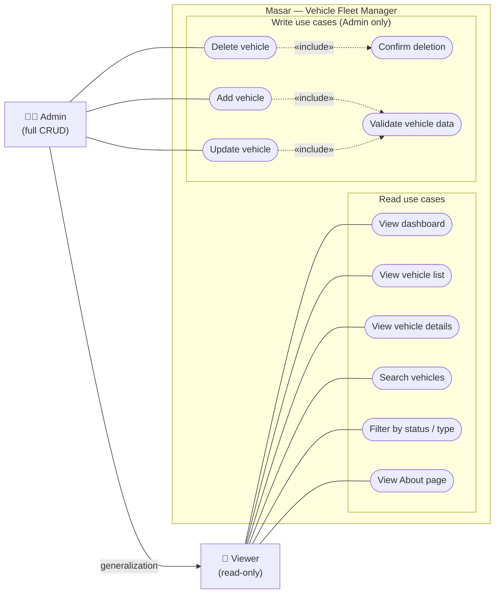

# Masar — Vehicle Fleet Manager

| | |
|---|---|
| **Document** | Software Requirements Specification (Part 1) |
| **Project** | Masar — Vehicle Fleet Manager (React.js frontend) |
| **Repository** | <https://github.com/Fahadd2/Masar> |
| **Phase** | Part 1 — frontend only, in-memory data |
| **Version** | 1.3 |
| **Date** | 2026-10-17 |

### Change log

| Version | Date | Changes |
|---|---|---|
| 1.3 | 2026-10-17 | Renamed the app to **Masar** (subtitle "Vehicle Fleet Manager"): title, project line, overview, About page (FR-40), NFR-19 (README title, package name `masar-fleet-manager`) and use case diagram. Added FR-47 and AC-1.5 (navbar logo text and `document.title` format). Added the repository link. |
| 1.2 | 2026-10-17 | §2.3: on a failed submit, focus moves to the error summary (each error links to its field), instead of to the first invalid field — matches DESIGN §5.1. |
| 1.1 | 2026-10-17 | `id` rule now uses a `nextId` counter (never reused); AC-4.7 aligned. App starts in the **Admin** role (FR-42, AC-10.1, §7.3). V-PL-3 restricted to Saudi plate letters; plate examples changed to `ABD 1234`. Use case diagram generalization drawn as a solid arrow, with a note on UML notation. |
| 1.0 | 2026-10-17 | First version. |

## Contents

1. [Project overview and scope](#1-project-overview-and-scope)
2. [Data model: Vehicle](#2-data-model-vehicle)
3. [Functional requirements](#3-functional-requirements)
4. [Non-functional requirements](#4-non-functional-requirements)
5. [User stories and acceptance criteria](#5-user-stories-and-acceptance-criteria)
6. [Seed data](#6-seed-data)
7. [User roles and permissions](#7-user-roles-and-permissions)
8. [Out of scope for Part 1](#8-out-of-scope-for-part-1)
9. [Glossary](#9-glossary)

---

## 1. Project overview and scope

### 1.1 Purpose

Companies that own a fleet of vehicles need to know, at a glance, which vehicles they have, who is
driving them, which department they belong to, what state they are in, and when they need servicing.
**Masar** (subtitle: *Vehicle Fleet Manager*) is a web application that lets fleet staff browse, search, add, update
and delete vehicle records, and see a dashboard summarising the fleet.

### 1.2 Project phases

| | **Part 1 (this document)** | **Part 2 (later)** |
|---|---|---|
| Deliverable | React.js single-page application | Backend coded manually, connected to the Part 1 frontend |
| Data | In-memory array of JavaScript objects, loaded from seed data when the app starts | Persistent database |
| Persistence | None — all changes are lost on page reload | Changes are stored permanently |
| Validation | Client-side only (for user experience) | Client-side **and** server-side (authoritative) |
| Users and roles | Simulated with a role switcher in the navbar (demo only) | Real authentication and server-side authorization |
| API | None; components call a local data-access module | REST API replaces the local data-access module |

### 1.3 Part 1 scope

Part 1 delivers:

- A navigation menu shared by all pages.
- A dashboard with fleet statistics.
- A vehicle list (table) with search and filters.
- A vehicle details page.
- Add, edit and delete vehicle functions with validation and a delete confirmation.
- An About page listing the team members.
- A simulated Admin / Viewer role switcher.

### 1.4 Design constraint that prepares for Part 2

All reads and writes of vehicle data **must go through a single data-access module** (for example
`vehicleService`) that exposes functions such as `getAll`, `getById`, `create`, `update` and `remove`.
UI components must never modify the in-memory array directly. In Part 2 only this module is rewritten
to call the backend API; the pages and components should not need to change. The module's functions
should return Promises even in Part 1, so that switching to network calls in Part 2 does not change
how components use them.

### 1.5 Pages (screen inventory)

| Page | Suggested route | Purpose |
|---|---|---|
| Dashboard | `/` | Fleet summary statistics and service-due list |
| Vehicle list | `/vehicles` | Table of all vehicles, with search and filters |
| Vehicle details | `/vehicles/:id` | All fields of one vehicle |
| Add vehicle | `/vehicles/new` | Form to create a vehicle (Admin only) |
| Edit vehicle | `/vehicles/:id/edit` | Form to update a vehicle (Admin only) |
| About | `/about` | Team members' names and student IDs |
| Access denied | `/vehicles/new`, `/vehicles/:id/edit` when Viewer | Shown in place of Admin-only forms (FR-45) |
| Not found | any other route | "Page not found" message with a link back to the dashboard |

---

## 2. Data model: Vehicle

### 2.1 Fields

| Field | Type | Required | Description |
|---|---|---|---|
| `id` | integer | auto | Unique identifier, generated by the application |
| `plateNumber` | string | yes | Saudi-style licence plate, format `ABD 1234` |
| `make` | string | yes | Manufacturer, e.g. `Toyota` |
| `model` | string | yes | Model name, e.g. `Hilux` |
| `year` | integer | yes | Model year |
| `type` | enum | yes | `Sedan` \| `SUV` \| `Pickup` \| `Van` \| `Truck` |
| `assignedDriver` | string | conditional | Full name of the driver the vehicle is assigned to |
| `department` | enum | yes | Department that owns the vehicle |
| `mileage` | integer | yes | Odometer reading in kilometres (km) |
| `status` | enum | yes | `Available` \| `In Use` \| `Under Maintenance` \| `Retired` |
| `purchaseDate` | date (`YYYY-MM-DD`) | yes | Date the company bought the vehicle |
| `purchasePrice` | number | yes | Purchase price in Saudi riyals (SAR) |
| `nextServiceDate` | date (`YYYY-MM-DD`) | conditional | Date of the next scheduled service |

Example record:

```json
{
  "id": 1,
  "plateNumber": "KSA 4821",
  "make": "Toyota",
  "model": "Hilux",
  "year": 2022,
  "type": "Pickup",
  "assignedDriver": "Abdullah Al-Qahtani",
  "department": "Operations",
  "mileage": 68450,
  "status": "In Use",
  "purchaseDate": "2022-03-15",
  "purchasePrice": 98500,
  "nextServiceDate": "2026-11-05"
}
```

### 2.2 Validation rules

General rules for every text field: leading and trailing spaces are removed (trimmed) before
validation and before saving; a field that contains only spaces counts as empty.

| Field | Rules | Example error message |
|---|---|---|
| `id` | Taken from a `nextId` counter kept inside the data-access module. The counter is initialised to (highest seed id + 1) when the app starts and incremented on every create. Ids are never entered or edited by the user and are never reused — not even after the vehicle with the highest id is deleted (e.g. with seed ids 1–10, delete vehicle 10, then add a vehicle: it gets id 11, not 10). | — |
| `plateNumber` | **V-PL-1** Required. **V-PL-2** Converted to upper case before validation. **V-PL-3** Must match `^[ABDEGHJKLNRSTUVXZ]{3} [0-9]{4}$` — exactly 3 letters from the Saudi plate letter set (A B D E G H J K L N R S T U V X Z, see [section 6](#6-seed-data)), one space, 4 digits. **V-PL-4** Must be unique across all vehicles (case-insensitive); when editing, the vehicle's own current plate does not count as a duplicate. | "Plate number must look like ABD 1234, using only the letters A B D E G H J K L N R S T U V X Z." / "A vehicle with plate KSA 4821 already exists." |
| `make` | **V-MK-1** Required. **V-MK-2** 2–30 characters. **V-MK-3** Letters (English or Arabic), spaces and hyphens only. | "Make must be 2–30 letters." |
| `model` | **V-MD-1** Required. **V-MD-2** 1–30 characters. **V-MD-3** Letters, digits, spaces and hyphens only (e.g. `F-150`, `D-Max`). | "Model may contain only letters, digits, spaces and hyphens." |
| `year` | **V-YR-1** Required. **V-YR-2** Whole number. **V-YR-3** Between 1990 and (current year + 1) inclusive. | "Year must be between 1990 and 2027." |
| `type` | **V-TY-1** Required. **V-TY-2** One of `Sedan`, `SUV`, `Pickup`, `Van`, `Truck` (chosen from a drop-down). | "Select a vehicle type." |
| `assignedDriver` | **V-DR-1** Required when `status` is `In Use`. **V-DR-2** Must be empty when `status` is `Retired`. **V-DR-3** If given: 3–50 characters; letters (English or Arabic), spaces, hyphens and apostrophes only. | "A vehicle that is In Use must have an assigned driver." |
| `department` | **V-DP-1** Required. **V-DP-2** One of `Operations`, `Logistics`, `Sales`, `Projects`, `Administration`, `Maintenance` (chosen from a drop-down). | "Select a department." |
| `mileage` | **V-MI-1** Required. **V-MI-2** Whole number. **V-MI-3** Between 0 and 2,000,000 km inclusive. **V-MI-4** When editing, mileage may not be lower than the value already saved (an odometer does not go backwards). | "Mileage cannot be lower than the current 68,450 km." |
| `status` | **V-ST-1** Required. **V-ST-2** One of `Available`, `In Use`, `Under Maintenance`, `Retired`. **V-ST-3** Defaults to `Available` on the Add form. | "Select a status." |
| `purchaseDate` | **V-PD-1** Required. **V-PD-2** A valid calendar date in `YYYY-MM-DD` format. **V-PD-3** Not in the future. **V-PD-4** Not earlier than 1 January of (`year` − 1) — a car can be bought before its model year starts, but not long before. | "Purchase date cannot be in the future." |
| `purchasePrice` | **V-PP-1** Required. **V-PP-2** A number greater than 0 and at most 10,000,000 SAR. **V-PP-3** At most 2 decimal places. Displayed as `SAR 98,500.00`. | "Purchase price must be between 0.01 and 10,000,000 SAR." |
| `nextServiceDate` | **V-NS-1** Required unless `status` is `Retired` (for a retired vehicle it is optional and ignored). **V-NS-2** A valid calendar date in `YYYY-MM-DD` format. **V-NS-3** Must be after `purchaseDate`. **V-NS-4** May be in the past — such a vehicle is shown as **Overdue**. | "Next service date must be after the purchase date." |

### 2.3 Validation behaviour

- Validation runs when a field loses focus and again for all fields when the form is submitted.
- Errors are shown next to the field they belong to, in text (not only colour).
- On a failed submit, an **error summary** listing every error appears at the top of the form and
  **receives focus**. Each error in the summary is a link that moves focus to its field.
- The form cannot be saved while any rule fails.
- Cross-field rules (V-DR-1, V-DR-2, V-PD-4, V-NS-1, V-NS-3) are re-checked when the related field
  changes (for example, changing `status` to `In Use` re-checks `assignedDriver`).
- The same validation function is used by the Add and Edit forms, and the data-access module checks
  plate uniqueness again before saving.

### 2.4 Derived values (not stored)

| Value | Definition |
|---|---|
| **Service overdue** | Status is not `Retired` and `nextServiceDate` is before today. |
| **Service due soon** | Status is not `Retired` and `nextServiceDate` is between today and today + 30 days, inclusive. |
| **Vehicle age** | Current year − `year`. Shown on the details page. |

---

## 3. Functional requirements

Requirements marked **(Admin)** are available only when the Admin role is selected (see
[section 7](#7-user-roles-and-permissions)). All others are available to both roles.

### Navigation

- **FR-1** The application shall show a navigation bar at the top of every page with links to
  Dashboard, Vehicles and About, plus an "Add Vehicle" link that is shown only to Admins.
- **FR-2** The link for the current page shall be visually highlighted.
- **FR-3** The navigation bar shall contain a role switcher (Admin / Viewer) and show the currently
  selected role.
- **FR-4** On narrow screens (below 768 px wide) the navigation links shall collapse into a menu
  button that opens and closes the link list.
- **FR-5** Any unknown URL shall show a "Page not found" page with a link back to the Dashboard.
- **FR-47** The navigation bar shall show "Masar" as the logo text, linking to the Dashboard. Every
  page shall set the browser tab title (`document.title`) to "*page name* — Masar"
  (e.g. "Dashboard — Masar").

### Display all vehicles

- **FR-6** The Vehicles page shall display all vehicles in a table with the columns: Plate number,
  Make, Model, Year, Type, Assigned driver, Department, Mileage (km), Status, Next service date, and
  Actions.
- **FR-7** Status shall be shown as a coloured badge with its text label
  (Available = green, In Use = blue, Under Maintenance = amber, Retired = grey).
- **FR-8** Mileage shall be formatted with thousands separators (e.g. `68,450 km`); an empty driver
  shall be shown as "Unassigned".
- **FR-9** A next service date that is overdue shall be marked "Overdue"; one that is due within 30
  days shall be marked "Due soon".
- **FR-10** The table shall be sortable by Plate number, Make, Year, Mileage and Next service date by
  clicking the column header; clicking again reverses the order.
- **FR-11** The page shall show how many vehicles are displayed out of the total
  (e.g. "Showing 4 of 10 vehicles").
- **FR-12** When there are no vehicles, or no vehicles match the search and filters, the table shall
  be replaced by a clear message (e.g. "No vehicles match your search.").

### View a single vehicle

- **FR-13** Clicking a row's plate number or its "View" action shall open the Vehicle details page,
  which shows every field of that vehicle with readable labels, plus the derived vehicle age and
  service state.
- **FR-14** Purchase price shall be formatted as `SAR 98,500.00` and dates in a readable form
  (e.g. `15 Mar 2022`).
- **FR-15** If the id in the URL does not match any vehicle, the page shall show "Vehicle not found"
  with a link back to the Vehicles page.
- **FR-16** **(Admin)** The details page shall offer Edit and Delete buttons.

### Add a vehicle

- **FR-17** **(Admin)** The Add Vehicle page shall show a form with an input for every field except
  `id`. `type`, `department` and `status` use drop-downs; dates use date inputs; numbers use number
  inputs.
- **FR-18** **(Admin)** On submit, the form shall validate every field using the rules in
  [section 2.2](#22-validation-rules) and show errors without saving if any rule fails.
- **FR-19** **(Admin)** On successful submit, the vehicle shall be added to the in-memory collection
  with a new id, a success message shall be shown ("Vehicle KSA 4821 added."), and the user shall be
  taken to the new vehicle's details page.
- **FR-20** **(Admin)** A Cancel button shall discard the input and return to the Vehicles page
  without saving.

### Update a vehicle

- **FR-21** **(Admin)** The Edit Vehicle page shall show the same form as Add, pre-filled with the
  vehicle's current values. The `id` is shown read-only.
- **FR-22** **(Admin)** On submit, the same validation shall run (with the edit-specific rules V-PL-4
  and V-MI-4), and on success the vehicle shall be updated in place, a success message shown, and the
  user taken to the vehicle's details page.
- **FR-23** **(Admin)** Cancel shall discard changes and return to the details page.
- **FR-24** **(Admin)** If the vehicle id does not exist, the Edit page shall show "Vehicle not
  found".

### Delete a vehicle

- **FR-25** **(Admin)** A Delete action shall be available in each table row and on the details page.
- **FR-26** **(Admin)** Clicking Delete shall open a confirmation dialog naming the vehicle
  ("Delete vehicle KSA 4821 — Toyota Hilux? This cannot be undone.") with Cancel and Delete buttons.
  Cancel is the default focused button, and pressing Escape cancels.
- **FR-27** **(Admin)** Confirming shall remove the vehicle from the in-memory collection, show a
  success message, and, if the user was on the details page, return them to the Vehicles page.
- **FR-28** **(Admin)** Cancelling shall close the dialog and change nothing.

### Search and filter

- **FR-29** The Vehicles page shall have a single search box that matches, case-insensitively and
  as a substring, against plate number, make, model and assigned driver
  (e.g. "hil" matches Toyota **Hil**ux; "4821" matches KSA **4821**).
- **FR-30** The Vehicles page shall have a Status filter (All, Available, In Use, Under Maintenance,
  Retired) and a Type filter (All, Sedan, SUV, Pickup, Van, Truck).
- **FR-31** Search and filters shall combine with AND logic and update the table as the user types or
  selects, without a submit button.
- **FR-32** A "Clear" button shall reset the search box and both filters.

### Dashboard

- **FR-33** The Dashboard shall show the total number of vehicles.
- **FR-34** The Dashboard shall show the number of vehicles in each status (Available, In Use,
  Under Maintenance, Retired), including statuses with a count of zero.
- **FR-35** The Dashboard shall list the vehicles whose service is overdue or due within the next 30
  days (see [section 2.4](#24-derived-values-not-stored)), excluding Retired vehicles, sorted by next
  service date (earliest first), showing plate number, make and model, next service date and days
  remaining (or days overdue). Each entry links to the vehicle's details page.
- **FR-36** The service-due list shall show its count (e.g. "5 vehicles need service within 30 days")
  and a message such as "No services due in the next 30 days." when it is empty.
- **FR-37** Dashboard figures shall reflect the current in-memory data, including adds, edits and
  deletes made earlier in the same session.
- **FR-38** Clicking a status count shall open the Vehicles page with that status filter applied.

### About

- **FR-39** The About page shall list each team member's full name and student ID.
- **FR-40** The About page shall show the project name ("Masar — Vehicle Fleet Manager"), course,
  and a one-paragraph description of the project.
- **FR-41** Team member details shall be stored in one data file so they can be updated without
  changing page code.

### Roles

- **FR-42** The application shall start in the **Admin** role, so that all CRUD features are visible
  immediately (e.g. to a grader). Because the role switcher is not a security control (NFR-24),
  defaulting to Viewer would give no protection and would only hide features.
- **FR-43** Switching role shall take effect immediately on the current page without reloading
  and without losing vehicle data.
- **FR-44** In the Viewer role, every create, edit and delete control shall be hidden.
- **FR-45** If a Viewer opens an Admin-only URL directly (e.g. `/vehicles/new` or
  `/vehicles/3/edit`), the application shall show an **Access denied** page ("You need the Admin role
  to add or edit vehicles.") instead of the form, without changing the URL. If the role is switched to
  Viewer while on such a page, the Access denied page replaces the form.

### Feedback

- **FR-46** Success and error messages for add, update and delete shall appear as a short
  notification that disappears after about 4 seconds and can also be dismissed manually.

---

## 4. Non-functional requirements

### 4.1 Usability

- **NFR-1** A first-time user shall be able to find, add, edit or delete a vehicle without
  instructions; every action is reachable in at most two clicks from the navigation bar.
- **NFR-2** All form inputs shall have visible labels; required fields are marked with an asterisk
  and explained in a legend ("* required").
- **NFR-3** Error messages shall say what is wrong and how to fix it (see examples in
  [section 2.2](#22-validation-rules)).
- **NFR-4** Destructive actions (Delete) shall use a distinct colour and always require
  confirmation.
- **NFR-5** Terminology, button labels and layout shall be consistent across pages
  (e.g. always "Vehicle", never mixing "Car" and "Vehicle").

### 4.2 Accessibility

- **NFR-6** The application shall be fully usable with the keyboard only, with a visible focus
  indicator.
- **NFR-7** Text and essential UI elements shall meet WCAG 2.1 AA contrast (4.5:1 for normal text).
- **NFR-8** Information shall never be conveyed by colour alone (status badges include text; errors
  include text).
- **NFR-9** Use semantic HTML (`<nav>`, `<main>`, `<table>` with `<th scope>`, `<label for>`); the
  confirmation dialog shall trap focus and return it to the triggering button when closed.

### 4.3 Responsiveness and compatibility

- **NFR-10** Layouts shall work from 320 px (small phone) to 1920 px (desktop) wide, with no
  horizontal page scrolling except inside the vehicle table's own scroll container on small screens.
- **NFR-11** On screens narrower than 768 px, the vehicle table may switch to a stacked card layout or
  scroll horizontally within its container; forms shall switch to a single column.
- **NFR-12** The application shall work in the current versions of Chrome, Edge, Firefox and Safari.

### 4.4 Performance

- **NFR-13** Search and filter results shall update within 200 ms for a collection of up to 1,000
  vehicles.
- **NFR-14** The initial page shall load within 2 seconds on a typical broadband connection when
  served as a production build.

### 4.5 Maintainability

- **NFR-15** The code shall be organised by responsibility: `pages/` (one component per route),
  `components/` (reusable UI such as the table, form, dialog, badge), `data/` (seed data, team
  members), `services/` (data-access module), `utils/` (validation, formatting, date helpers),
  `context/` (role and vehicle state).
- **NFR-16** All vehicle data access shall go through the data-access module described in
  [section 1.4](#14-design-constraint-that-prepares-for-part-2).
- **NFR-17** Validation rules shall live in one module used by both the Add and Edit forms; enum
  values (types, statuses, departments) shall be defined once as constants and reused everywhere.
- **NFR-18** Components shall be functional components using React hooks; names shall be descriptive
  (`VehicleTable`, `VehicleForm`, `ConfirmDialog`).
- **NFR-19** The project shall include a `README.md` titled "Masar" explaining how to install, run and
  build it, and shall use a linter (ESLint) with no errors. The npm package name is
  `masar-fleet-manager`.
- **NFR-20** Validation and formatting utilities should have unit tests.

### 4.6 Input validation and security

- **NFR-21** Every user input shall be validated according to [section 2.2](#22-validation-rules)
  before it is saved; invalid data shall never enter the in-memory collection.
- **NFR-22** User-entered text shall only be rendered through React's normal JSX output (which escapes
  HTML). `dangerouslySetInnerHTML`, `eval` and building HTML from strings are forbidden.
- **NFR-23** Text inputs shall have a `maxLength` matching their validation limit.
- **NFR-24** Client-side validation and the role switcher exist only for user experience and
  demonstration. They are **not** security controls, because anyone can change code running in their
  own browser. Part 2 must repeat all validation and enforce authorization on the server.
- **NFR-25** No real personal or sensitive data shall be used in seed data; all driver names are
  fictional.
- **NFR-26** The application shall not crash on unexpected input (e.g. a non-numeric id in the URL);
  it shall show a friendly "not found" message instead.

---

## 5. User stories and acceptance criteria

Acceptance criteria use the *Given / When / Then* format. "Admin" and "Viewer" refer to the role
selected in the role switcher.

### US-1 Navigate the application (FR-1 – FR-5, FR-47)

> As a **fleet user**, I want a navigation menu on every page, so that I can move between sections
> quickly.

- **AC-1.1** Given I am on any page, when I look at the top of the page, then I see links to
  Dashboard, Vehicles and About, and the link for the current page is highlighted.
- **AC-1.2** Given I am an Admin, then I also see an "Add Vehicle" link; given I am a Viewer, then I
  do not.
- **AC-1.3** Given my screen is narrower than 768 px, when I tap the menu button, then the links
  appear; when I tap a link, then the page changes and the menu closes.
- **AC-1.4** Given I enter an unknown URL, then I see "Page not found" and a link to the Dashboard.
- **AC-1.5** Given I am on any page, then the navbar logo reads "Masar" and the browser tab title is
  "*page name* — Masar" (e.g. "Dashboard — Masar" on the Dashboard).

### US-2 See all vehicles (FR-6 – FR-12)

> As a **fleet user**, I want to see all vehicles in a table, so that I have an overview of the fleet.

- **AC-2.1** Given the seed data is loaded, when I open the Vehicles page, then I see 10 rows with all
  the columns listed in FR-6 and the text "Showing 10 of 10 vehicles".
- **AC-2.2** Given a vehicle has no assigned driver, then its driver cell shows "Unassigned".
- **AC-2.3** Given a vehicle's next service date is before today, then that cell shows "Overdue".
- **AC-2.4** When I click the "Mileage" header, then rows are sorted by mileage ascending; when I click
  it again, then they are sorted descending.
- **AC-2.5** Given all vehicles have been deleted, then I see a "No vehicles" message instead of an
  empty table.

### US-3 View a vehicle's details (FR-13 – FR-16)

> As a **fleet user**, I want to open one vehicle's full record, so that I can see all of its
> information.

- **AC-3.1** When I click plate "KSA 4821" in the table, then I am taken to `/vehicles/1` and see all
  its fields, including "SAR 98,500.00" as the purchase price.
- **AC-3.2** Given I open `/vehicles/999` or `/vehicles/abc`, then I see "Vehicle not found" and a link
  back to the Vehicles page.
- **AC-3.3** Given I am an Admin, then I see Edit and Delete buttons; given I am a Viewer, then I do
  not.

### US-4 Add a vehicle (FR-17 – FR-20)

> As an **Admin**, I want to add a new vehicle, so that the fleet list stays complete.

- **AC-4.1** Given I am an Admin on the Add Vehicle page, when I fill every field with valid values
  and click Save, then the vehicle appears in the table, a "Vehicle … added." message is shown, and I
  am taken to its details page.
- **AC-4.2** When I submit with the plate "abd12", or with "ABC 1234" (C is not a Saudi plate letter),
  then I see "Plate number must look like ABD 1234, using only the letters A B D E G H J K L N R S T U
  V X Z." and nothing is saved.
- **AC-4.3** When I enter the plate "ksa 4821" (already used by vehicle 1), then I see a duplicate
  plate error.
- **AC-4.4** When I set status to "In Use" and leave the driver empty, then I see "A vehicle that is
  In Use must have an assigned driver."
- **AC-4.5** When I enter a purchase date in the future, a year of 1985, a negative mileage or a price
  of 0, then each field shows its own error.
- **AC-4.6** When I click Cancel, then I return to the Vehicles page and no vehicle is added.
- **AC-4.7** Given the seed data (ids 1–10) is loaded, when I add a vehicle, then it gets id 11; and
  given I then delete vehicle 11 and add another vehicle, then the new vehicle gets id 12 (the
  `nextId` counter only increases, so id 11 is never reused).

### US-5 Update a vehicle (FR-21 – FR-24)

> As an **Admin**, I want to edit a vehicle's information, so that records stay accurate (for example,
> after a driver change or a service).

- **AC-5.1** Given I am an Admin, when I click Edit on vehicle 1, then the form is pre-filled with its
  current values and the id is read-only.
- **AC-5.2** When I change the mileage from 68,450 to 69,100 and click Save, then the details page
  shows 69,100 km and a success message.
- **AC-5.3** When I save without changing the plate, then no duplicate-plate error appears.
- **AC-5.4** When I change the plate to one used by another vehicle, then I see a duplicate-plate
  error.
- **AC-5.5** When I lower the mileage below the saved value, then I see "Mileage cannot be lower than
  the current … km."
- **AC-5.6** When I click Cancel, then I return to the details page and no changes are saved.

### US-6 Delete a vehicle (FR-25 – FR-28)

> As an **Admin**, I want to delete a vehicle that is no longer part of the fleet, with a confirmation
> step, so that I do not remove one by mistake.

- **AC-6.1** When I click Delete for vehicle "KSA 4821", then a dialog asks "Delete vehicle KSA 4821 —
  Toyota Hilux? This cannot be undone." with Cancel focused.
- **AC-6.2** When I click Cancel or press Escape, then the dialog closes and the vehicle is still
  listed.
- **AC-6.3** When I click Delete in the dialog, then the vehicle disappears from the table, the total
  count drops by one, and a success message is shown.
- **AC-6.4** Given I deleted from the details page, then I am returned to the Vehicles page.

### US-7 Search and filter vehicles (FR-29 – FR-32)

> As a **fleet user**, I want to search and filter the vehicle list, so that I can find specific
> vehicles quickly.

- **AC-7.1** When I type "hilux", then only Toyota Hilux vehicles are shown.
- **AC-7.2** When I type "qahtani", then vehicles assigned to Abdullah Al-Qahtani are shown.
- **AC-7.3** When I type "4821", then the vehicle with plate KSA 4821 is shown.
- **AC-7.4** When I choose Status "In Use" and Type "Pickup", then only vehicles that are both In Use
  and Pickups are shown.
- **AC-7.5** When nothing matches, then I see "No vehicles match your search."
- **AC-7.6** When I click Clear, then the search box is empty, both filters are "All", and all
  vehicles are shown.

### US-8 See the dashboard (FR-33 – FR-38)

> As a **fleet manager**, I want a dashboard summary, so that I can see the state of the fleet and
> upcoming services at a glance.

- **AC-8.1** Given the seed data and today's date is 2026-10-17, when I open the Dashboard, then I see
  Total = 10, Available = 3, In Use = 4, Under Maintenance = 2, Retired = 1.
- **AC-8.2** Given the same conditions, then the service list shows 5 vehicles, sorted by date, with
  TXE 7712 first and marked as overdue.
- **AC-8.3** Given I delete a vehicle, when I return to the Dashboard, then the counts reflect the
  deletion.
- **AC-8.4** When I click the "In Use" count, then I am taken to the Vehicles page filtered to In Use.
- **AC-8.5** Given no vehicle is due for service within 30 days, then the list shows "No services due
  in the next 30 days."

### US-9 See the team on the About page (FR-39 – FR-41)

> As a **course instructor**, I want an About page listing the team members, so that I know who built
> the project.

- **AC-9.1** When I open the About page, then I see each team member's full name and student ID.
- **AC-9.2** Then I also see the project name, course and a short project description.

### US-10 Switch roles (FR-42 – FR-45)

> As a **demonstrator**, I want to switch between Admin and Viewer, so that I can show how the
> interface changes for each role.

- **AC-10.1** When the app first loads (or the page is reloaded), then the role is Admin and the Add,
  Edit and Delete controls are visible.
- **AC-10.2** When I switch to Viewer, then no Add, Edit or Delete controls are visible anywhere.
- **AC-10.3** When I switch back to Admin, then those controls appear immediately without a page
  reload, and data I changed earlier is still there.
- **AC-10.4** Given I am a Viewer, when I open `/vehicles/new` or `/vehicles/1/edit` directly, then I
  see the Access denied page, the URL is unchanged, and no form is shown.

### Traceability summary

| User story | Functional requirements |
|---|---|
| US-1 Navigation | FR-1 – FR-5, FR-47 |
| US-2 List vehicles | FR-6 – FR-12 |
| US-3 Vehicle details | FR-13 – FR-16 |
| US-4 Add vehicle | FR-17 – FR-20, FR-46 |
| US-5 Update vehicle | FR-21 – FR-24, FR-46 |
| US-6 Delete vehicle | FR-25 – FR-28, FR-46 |
| US-7 Search and filter | FR-29 – FR-32 |
| US-8 Dashboard | FR-33 – FR-38 |
| US-9 About | FR-39 – FR-41 |
| US-10 Roles | FR-42 – FR-45 |

---

## 6. Seed data

The application loads these 10 vehicles into memory when it starts. All driver names are fictional.
Plates use letters from the Latin equivalents of Saudi plate letters
(A B D E G H J K L N R S T U V X Z).

| id | plateNumber | make | model | year | type | assignedDriver | department | mileage (km) | status | purchaseDate | purchasePrice (SAR) | nextServiceDate |
|---|---|---|---|---|---|---|---|---:|---|---|---:|---|
| 1 | KSA 4821 | Toyota | Hilux | 2022 | Pickup | Abdullah Al-Qahtani | Operations | 68,450 | In Use | 2022-03-15 | 98,500 | 2026-11-05 |
| 2 | RJD 1507 | Hyundai | Accent | 2023 | Sedan | Mohammed Al-Harbi | Sales | 41,200 | In Use | 2023-01-10 | 62,000 | 2027-01-20 |
| 3 | LNB 3390 | Toyota | Land Cruiser | 2021 | SUV | Faisal Al-Dosari | Administration | 92,750 | Available | 2021-06-01 | 295,000 | 2026-10-28 |
| 4 | TXE 7712 | Nissan | Patrol | 2020 | SUV | — | Projects | 154,300 | Under Maintenance | 2020-02-20 | 240,000 | 2026-10-10 |
| 5 | HDA 2045 | Isuzu | D-Max | 2022 | Pickup | Saad Al-Otaibi | Logistics | 77,900 | In Use | 2022-08-12 | 89,000 | 2026-12-15 |
| 6 | ZGU 6630 | Toyota | Hiace | 2021 | Van | Khalid Al-Shehri | Logistics | 121,400 | In Use | 2021-11-03 | 135,000 | 2026-11-12 |
| 7 | BVS 9081 | Mercedes-Benz | Actros | 2019 | Truck | Turki Al-Mutairi | Logistics | 312,600 | Available | 2019-05-22 | 480,000 | 2027-02-01 |
| 8 | ELK 4417 | Hyundai | Staria | 2024 | Van | — | Operations | 18,350 | Available | 2024-04-14 | 145,000 | 2027-04-14 |
| 9 | NAJ 1198 | Toyota | Camry | 2018 | Sedan | — | Administration | 241,800 | Retired | 2018-03-05 | 105,000 | — |
| 10 | DRT 5560 | Ford | F-150 | 2023 | Pickup | Nawaf Al-Ghamdi | Projects | 39,600 | Under Maintenance | 2023-07-19 | 185,000 | 2026-10-22 |

"—" means the field is empty.

**Coverage.** The seed data includes every vehicle type, every status, every department except
Maintenance, vehicles with and without drivers, one overdue service, several services due soon, and
one retired vehicle without a next service date. Every record satisfies all
validation rules in [section 2.2](#22-validation-rules).

**Expected dashboard values on 2026-10-17** (used by AC-8.1 and AC-8.2):

| Metric | Value |
|---|---|
| Total vehicles | 10 |
| Available | 3 (ids 3, 7, 8) |
| In Use | 4 (ids 1, 2, 5, 6) |
| Under Maintenance | 2 (ids 4, 10) |
| Retired | 1 (id 9) |
| Service overdue or due by 2026-11-16 | 5: TXE 7712 (overdue since 10 Oct), DRT 5560 (22 Oct), LNB 3390 (28 Oct), KSA 4821 (5 Nov), ZGU 6630 (12 Nov) |

Because "due within 30 days" depends on the real current date, the service-due list will change over
time. Before a demonstration, adjust the seed `nextServiceDate` values if needed so the list still
shows a mix of overdue, due-soon and later vehicles.

---

## 7. User roles and permissions

### 7.1 Roles

| Role | Description |
|---|---|
| **Admin** | Fleet administrator. Full CRUD: can view, search, filter, add, update and delete vehicles, and see the dashboard and About page. |
| **Viewer** | Read-only user (e.g. a department manager or auditor). Can view the vehicle list and details, search, filter, see the dashboard and About page. Cannot add, update or delete. |

### 7.2 Permissions matrix

| Action | Admin | Viewer |
|---|:---:|:---:|
| View dashboard | ✅ | ✅ |
| View vehicle list | ✅ | ✅ |
| View vehicle details | ✅ | ✅ |
| Search vehicles | ✅ | ✅ |
| Filter by status and type | ✅ | ✅ |
| Sort vehicle table | ✅ | ✅ |
| View About page | ✅ | ✅ |
| Add vehicle | ✅ | ❌ |
| Update vehicle | ✅ | ❌ |
| Delete vehicle | ✅ | ❌ |
| Switch role (Part 1 demo only) | ✅ | ✅ |

### 7.3 How roles work in Part 1 — simulation only

> ⚠️ **The Part 1 role switcher is a demonstration feature, not a security control.**

- In Part 1 the current role is held in client-side React state and chosen with a **role switcher in
  the navigation bar**. There is no login, no password and no user account.
- The switcher exists only to demonstrate that the interface adapts to each role: Admin-only controls
  are hidden from Viewers and Admin-only routes show an Access denied page.
- Anyone using the app can switch to Admin at any time, and anyone can change JavaScript running in
  their own browser. Hiding a button therefore **does not** protect data and must not be described as
  security.
- The app starts in the **Admin** role, and the role is not persisted, so reloading the page resets it
  to Admin (FR-42). Admin is the default so that every feature is visible straight away; since the
  switcher protects nothing, starting as Viewer would add no security and would only hide features.
- **Real authentication** (verifying who the user is) and **server-side authorization** (the backend
  rejecting create, update and delete requests from users who are not Admins) are **deferred to
  Part 2**. In Part 2 the role switcher will be removed and the role will come from the logged-in
  user's account.

### 7.4 Use case diagram

The two actors are related by generalization: **Admin is a specialised Viewer**. An Admin can do
everything a Viewer can, plus the three write use cases. The Viewer is associated only with read use
cases.



> **Notation note:** the solid `Admin → Viewer` arrow is an actor **generalization** (Admin inherits
> all of Viewer's use cases). In UML this is drawn as a solid line with a **hollow-triangle
> arrowhead** pointing at Viewer; Mermaid flowcharts cannot render that arrowhead, so a plain solid
> arrow with the label "generalization" is used instead. The dotted arrows are «include»
> relationships.

Actor distinction in words:

| | Viewer | Admin |
|---|---|---|
| Associated use cases | View dashboard, View vehicle list, View vehicle details, Search vehicles, Filter vehicles, View About page | All Viewer use cases (inherited) **plus** Add vehicle, Update vehicle, Delete vehicle |
| Can change data | No | Yes |
| Included use cases triggered | — | Validate vehicle data (on Add / Update), Confirm deletion (on Delete) |

---

## 8. Out of scope for Part 1

The following are explicitly **not** part of Part 1:

- Any backend server, REST API or database (Part 2).
- Persistence of data across page reloads — including `localStorage`, `sessionStorage`, IndexedDB,
  files or cookies. Data resets to the seed data on every reload.
- Real authentication (login, logout, passwords, sessions, tokens) and server-side authorization
  (Part 2).
- User account management (creating users, assigning roles).
- Server-side validation (Part 2).
- Multi-user or real-time updates.
- Maintenance and service history logs, fuel tracking, trip logs, GPS tracking, insurance and
  registration (Istimara) tracking, or expense reports.
- Uploading vehicle photos or documents.
- Import or export (CSV, Excel, PDF) and printing.
- Email, SMS or push notifications for upcoming services.
- Pagination of the vehicle table (the seed data is small; may be added later).
- Arabic language interface and right-to-left layout (English only in Part 1; Arabic names in data
  are allowed).
- Deployment to a public hosting service (optional, not required).

---

## 9. Glossary

| Term | Meaning |
|---|---|
| CRUD | Create, Read, Update, Delete |
| SAR | Saudi riyal |
| In-memory collection | A JavaScript array held in the running app; lost when the page reloads |
| Data-access module | The single module through which all vehicle reads and writes go (see 1.4) |
| Overdue | A non-retired vehicle whose next service date is before today |
| Due soon | A non-retired vehicle whose next service date is within the next 30 days |
| Role switcher | Navbar control that switches between Admin and Viewer for demonstration |
